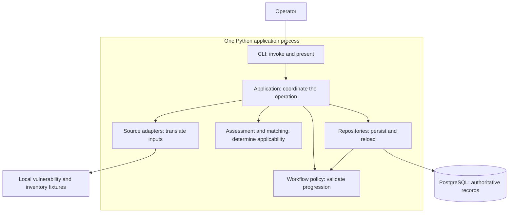
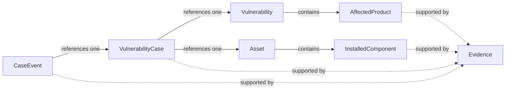

# VulnOps Day 1: architecture blueprint

This is the overview to read before the detailed walkthrough. It explains the
business purpose, the application structure, the business objects, and one actual
execution. The three diagrams show different views: runtime collaborators,
domain relationships, and execution order. Their arrows have different meanings,
explained beside each diagram.

## 1. The business goal determines the architecture

A vulnerability announcement does not equal enterprise risk. A security team needs
to connect an announcement to what its organisation runs, decide which assets need
attention, and eventually remediate them under controlled, auditable conditions.

Consider the repository's fictional CVE-2099-900001. Its advisory reports that Lab
Web is affected from 1.0.0 up to, but excluding, the fixed version 2.0.0. Three
servers report Lab Web 1.4.0, Lab Web 2.0.0, and an unknown version respectively.
The team needs three independent outcomes, supported by evidence. A single status
on the CVE cannot express that operational reality.

The full V1 business goal is verified remediation. Day 1 establishes the part on
which that goal depends: **an evidence-supported conclusion for each relevant
asset, tracked as a case whose progression and history are controlled.**

| Business need | Architectural response |
| --- | --- |
| Explain why an asset needs attention | Preserve source observations as Evidence and retain their references in findings and cases |
| Combine differently shaped intelligence and inventory | Translate sources into common domain models before applying business rules |
| Handle one CVE differently across assets | Create one VulnerabilityCase per relevant vulnerability/asset pair |
| Avoid false reassurance | Preserve UNKNOWN when identity, versions, or evidence are insufficient |
| Prevent shortcuts and reconstruct progress | Enforce a deterministic lifecycle and persist each state change with its event |
| Continue after a process exits | Keep authoritative records in PostgreSQL |

Day 1 does not prioritise risk, authenticate production approvals, patch systems,
or verify actual fixes. Later lifecycle state names already exist, but their
execution services do not. This guide describes the implemented foundation.

## 2. The application is organised around a coordinator, rules, and adapters

Today VulnOps runs as **one Python application process connected to PostgreSQL**.
Its CLI, application services, matching rules, workflow policy, and repositories
are Python modules in that process. They are not separately deployed services.
The lab fixtures are local input files; no live intelligence API is called.

### Runtime view: who collaborates with whom



An arrow means **invokes or accesses**. Return values are omitted. Domain models
are the values passed between these collaborators; they are explained in the next
section. Application composition also opens and commits the database transaction.

The application coordinator makes the pieces achieve a business operation. For
the demo it obtains translated inputs, asks the rules for assessments, plans cases
and transitions, invokes persistence, and checks committed results. It owns the
order of work and the transaction lifetime. A source adapter should not quietly
create a case; a matcher should not quietly approve one.

The two rule responsibilities are separate. Assessment asks whether the supplied
claims imply affectedness. Workflow asks whether a proposed lifecycle change is
legal. Repositories call workflow policy again when applying persisted changes,
so a precomputed plan cannot bypass the current stored state.

| Architectural part | Where it lives | Contract with the rest of the system |
| --- | --- | --- |
| Operator interface | [cli.py](../src/vulnops/cli.py) | Parse, dispatch, present JSON and exit status; leave business rules to application operations |
| Application coordination | [bootstrap.py](../src/vulnops/application/bootstrap.py), [walking_skeleton.py](../src/vulnops/application/walking_skeleton.py) | Compose collaborators and transaction boundaries; the persisted demo is a synthetic use case, not a generic ingestion service |
| Source adapters | [sources/](../src/vulnops/sources/) | Return canonical domain records with their Evidence; contain knowledge of source field names |
| Domain vocabulary | [domain/](../src/vulnops/domain/) | Define the records and their validation; no database sessions or agent framework |
| Assessment and matching | [assessment.py](../src/vulnops/application/assessment.py), [matching/](../src/vulnops/matching/) | Return findings from supplied inputs without database writes |
| Lifecycle policy | [workflow/](../src/vulnops/workflow/) | Return a validated replacement case and event, or deny the transition |
| Persistence | [persistence/](../src/vulnops/persistence/) | Map domain records to PostgreSQL, enforce tenant/reference scope, and apply case/event changes atomically |

### Code view: what depends on what

Calls during execution are different from imports in the code. In the current
implementation, application composition imports concrete fixture and PostgreSQL
implementations. The source protocol and demo/inspection repository protocols
provide selected boundaries; this is not a claim that every component is hidden
behind an interchangeable interface.

The important dependency direction is that source adapters and repositories
understand domain models, while those models do not understand source formats or
SQLAlchemy sessions. Matching and transition rules operate on domain values.
The case model shares the CaseState enum from `workflow/states.py`; framework
independence does not require completely isolated Python packages.

This organisation lets an engineer change a source mapping without rewriting
matching, or add another interface without copying business policy. It also
explains where future AI fits: it may coordinate or propose through application
boundaries, while the rules and database retain business authority.

## 3. The domain connects source claims to asset-specific work

There are two inputs to applicability. A **Vulnerability** describes the disclosed
problem and contains **AffectedProduct** claims. An **Asset** describes an enterprise
resource and contains **InstalledComponent** observations. Matching connects an
affected product to a reported installation. A **VulnerabilityCase** then gives
that vulnerability on that asset its own operational identity.



Solid arrows mean containment or an ID reference, as labelled. Dotted arrows mean
provenance references. This is a conceptual model, not a table diagram: source
objects are nested, components/events have their own stored rows, and evidence
references are not separate join tables. Additional provenance links on
vulnerabilities, assets, and scoring observations are omitted for clarity.

Inside AffectedProduct, **ProductIdentity** identifies the product through PURL,
CPE, ecosystem/package, and names; **VersionConstraint** represents the reported
exact version or release boundaries. InstalledComponent uses the same identity
type with an installed version. These are two observations about a product, not
one shared installation object.

For our example, the advisory side says `pkg:pypi/vulnops-lab-web`, introduced
1.0.0, fixed 2.0.0, under explicit `semver`. The inventory side says the same PURL
at version 1.4.0 on web-01. Identity matches; numeric release comparison places
1.4.0 inside the affected interval.

The resulting **AffectedResolution** is a finding for one component/product pair.
**AssetAssessment** combines those findings for the whole asset, retaining the
comparisons, reason, and evidence. These are computed result objects, not additional
database tables. The demo retains assessment detail in an event reason as well as
the case's affected status and evidence references.

Evidence preserves what a source reported and its attribution. Canonical records
express source claims in a usable common language. Findings interpret those claims.
A case tracks work on the asset-specific result. Keeping these responsibilities
separate lets a reviewer distinguish a wrong source observation from a wrong
comparison or an illegal workflow change.

The case has two independent axes: `affected_status` says what assessment concludes;
`state` says which lifecycle stage has been recorded. A newly created case can
therefore be AFFECTED and DISCOVERED. The demo computes assessment before creating
the case, then records its progression. Its priority remains None.

## 4. One execution connects the architecture to the business result

We can now follow `uv run vulnops demo`. Use the same three labels throughout:
**V** is CVE-2099-900001, **A** is web-01, and **C** is the case for V × A.
They abbreviate UUID-backed records, not new implementation types.

### The runtime sequence

```mermaid
sequenceDiagram
    participant CLI as CLI
    participant App as Application coordinator
    participant Source as Fixture adapters
    participant Rules as Assessment and workflow rules
    participant Repo as Repositories
    participant DB as PostgreSQL
    CLI->>App: run_walking_demo(lab_dir, tenant_id)
    App->>Source: Load selected vulnerability
    Source-->>App: V and source Evidence
    App->>DB: Begin tenant transaction
    App->>Repo: Save source Evidence, then V
    Repo->>DB: Insert or exact replay
    App->>Source: Load lab inventory inside prepare_demo
    Source-->>App: Assets, components, inventory Evidence
    App->>Rules: Assess assets; validate planned transitions
    Rules-->>App: Findings and planned cases/events
    App->>Repo: Save inventory, initial cases, append planned events
    loop Each new planned event
        Repo->>DB: Lock current case
        Repo->>Rules: Validate transition from stored state
        Rules-->>Repo: Replacement case and event
        Repo->>DB: Atomically update case and insert event
    end
    App->>Repo: Attempt prohibited approval, retain denial Evidence
    Repo->>Rules: Request AFFECTED_CONFIRMED to APPROVED
    Rules-->>Repo: Denied
    Repo->>DB: Preserve state/history; save explicit demo denial observation
    App->>Repo: Verify expected records before commit
    App->>DB: Commit outer transaction
    App->>Repo: Reload and verify in a new tenant transaction
    Repo->>DB: Read committed records and history
    Repo-->>App: Verified result
    App-->>CLI: Report eligible for acceptance PASS
```

Arrows now represent ordered messages, not ownership or import dependencies.
The diagram groups helper functions under their architectural roles and omits
repeated exact saves and individual readback calls. A rule/write/commit/readback
failure prevents PASS. This sequence is the success path including the expected
policy denial.

### What the operation establishes at each boundary

First, **the source boundary** converts the fictional advisory and enrichment
fixtures into V and attributable Evidence. Translation has not established enterprise
affectedness. Four source/enrichment observations are saved before inventory is
loaded. They remain uncommitted inside the tenant transaction.

Next, **the assessment boundary** receives V, A, its installations, and resolved
Evidence. web-01 has both Lab Web and Lab Common. The Web/Web comparison is AFFECTED;
the Common/Web comparison identifies different products. With no unknown comparison,
the asset assessment is AFFECTED. It is still an in-memory finding.

The asset policy checks UNKNOWN first: any unknown comparison, or no comparisons,
yields UNKNOWN. Otherwise a positive yields AFFECTED. All exclusions can yield
NOT_AFFECTED only with explicit asset-scoped inventory completeness evidence.
Thus web-02's fixed Web version plus complete inventory supports a negative;
legacy-01's missing version requires investigation. Completeness is itself a source
claim, not a guarantee of inventory truth.

At **the case/workflow boundary**, the application creates C in DISCOVERED with
the already computed AFFECTED status. Pure transition validation plans ENRICHED,
ASSET_MATCHED, and AFFECTED_CONFIRMED with events. The same CVE produces independent
cases for web-02, dev-01, and legacy-01. Different structured products make API/database
assets non-candidates for this selected CVE; their inventory is still saved.

At **the persistence boundary**, each new planned event is checked against the
locked stored case. The repository applies the expected-state/revision checks and
case update/event insert in a savepoint. The outer transaction commits the full
operation. This is when the result becomes durable, rather than merely planned.

Finally, **the verification boundary** reloads the committed records before the
CLI can report success. For C, the current state is AFFECTED_CONFIRMED, while its
history still contains each earlier from/to transition. The denied approval is
explicit SYSTEM Evidence from the demo probe, not a fabricated successful event.

### The code expresses that coordination

This excerpt from [bootstrap.py](../src/vulnops/application/bootstrap.py) is the
application-level write transaction. Source translation has already returned
`source`; the objects and rules described above are composed here:

```python
        with tenant_session(engine, tenant_id) as session:
            repository = Repositories(session, tenant_id)
            for evidence in source.evidence:
                repository.save_evidence(evidence)
            repository.save_vulnerability(source.vulnerability)
            plan = prepare_demo(lab_dir, source=source)
            blocked = persist_demo(repository, plan)
            verify_demo(repository, plan, blocked, tenant_id)
```

Leaving this context successfully commits. The following context in the actual
function opens a separate transaction for committed readback. The coordinator
chooses the order; assessment supplies findings; workflow supplies legal changes;
repositories enforce their durable application.

### What must survive failure or extension

If event insertion fails after updating C, the savepoint rolls both back, even if
the caller catches the exception. A stale worker fails expected-state/revision
checks. Queries and references remain tenant-scoped through explicit filters,
composite keys, forced RLS, and transaction-local context. The current CLI's tenant
and actor inputs are trusted local configuration, not authenticated authority.

Exact replay reuses stable source/case/event identities without adding work.
Changed snapshots conflict; refresh requires a future explicit reconciliation
operation. Events are append-oriented through application APIs and runtime grants,
but database owners can still alter them. A post-commit verification failure reports
failure while leaving committed records available for inspection.

These mechanisms explain where future changes belong. A live feed needs a source
adapter and application composition, plus reconciliation for updates. Another
version scheme belongs in matching. Prioritisation needs explicit asset-context
policy. A web console can reuse application operations. AI may propose or coordinate
through those boundaries; it cannot replace case authority with model output or
orchestrator checkpoints. Production tools still need authenticated human approval
bound to exact actions, default-deny execution, a global mutation kill switch,
independent verification, and rollback services.

The [acceptance harness](../tests/acceptance/test_day01.py) checks the business result
across these collaborators: evidence-backed affectedness, supported exclusions,
unknown/investigation, observable denied progression, provenance rejection, durable
restart, idempotency, and different asset outcomes for one CVE. Detailed guarantees
and open boundaries remain in the [invariants](invariants.md),
[decision ledger](day01-decision-ledger.md), and [security review](day01-security-review.md).

The architecture should now be reconstructable as a whole: **the application
coordinates source translation and deterministic rules, turns findings into
asset-specific cases, and commits controlled changes with their explanations.**
That is the foundation on which eventual verified remediation depends.
