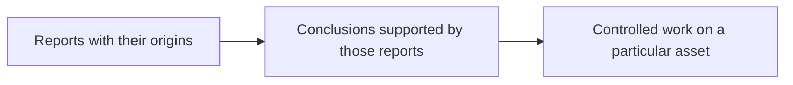
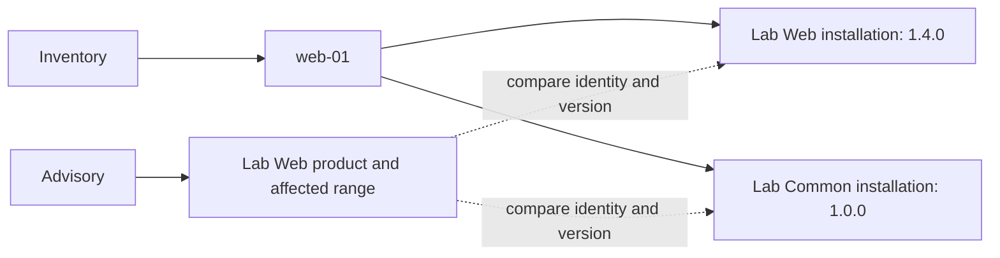
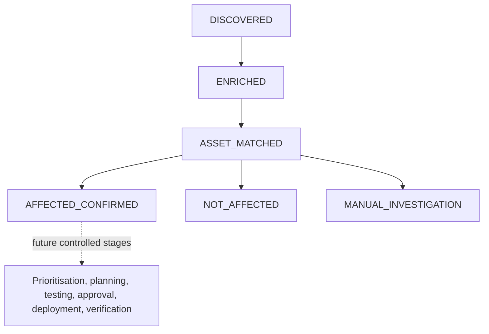

# Understanding VulnOps Day 1

A vulnerability announcement does not equal enterprise risk.

Suppose an advisory says that Lab Web versions from 1.0.0 up to, but excluding,
2.0.0 contain a vulnerability. You operate a server called web-01. Should you
remediate it?

The advisory cannot answer that question. You also need to know what web-01 runs.
If inventory reports Lab Web 1.4.0, you can connect the two reports and conclude
that the reported installation is affected. If inventory has no version, you
cannot complete that reasoning. If it reports 2.0.0, you have a basis for excluding
that installation from the advisory's affected range.

VulnOps makes this reasoning explicit and keeps its supporting records. It then
tracks work separately for each asset, under rules that control how that work may
progress. Day 1 builds this foundation; later days can add prioritisation and
remediation without having to invent a new account of why an asset needs attention.

The example throughout this guide comes from the repository's fictional
`CVE-2099-900001` and Lab Web fixtures. No real CVE or package is being assessed.
The lab containers are inert stand-ins; their inventory is synthetic input.

## The mental model: reports, conclusions, and controlled work

Keep three questions separate as you read:

1. **What was reported, and by whom?** An advisory reports an affected range.
   Inventory reports an installed version. We preserve both reports and their origins.
2. **What follows from those reports?** A matching rule compares product identity
   and version. Its conclusion must point back to the reports that support it.
3. **What work has been recorded or authorised?** A case tracks this vulnerability
   on this asset. Lifecycle policy controls the changes to that case.



Each arrow adds something. The first adds interpretation: a version is inside an
affected range. The second adds workflow: a case progresses through permitted
stages. Neither arrow makes the original source infallible.

This distinction is useful when something goes wrong. A bad installed version is
an inventory problem. An incorrect range comparison is a matching problem. An
approval shortcut is a workflow problem. They need different fixes, and the system
must retain enough information to tell them apart.

We will first build the left side of this diagram, then follow one conclusion into
a case and its durable history. Code comes after that reasoning is established.

## 1. Start with two reports, not an affected asset

Our investigation begins with an advisory:

> For CVE-2099-900001, the package vulnops-lab-web is affected from version 1.0.0
> until the fixed version 2.0.0.

That is a readable restatement of [the actual fixture](../lab/fixtures/vulnerabilities/CVE-2099-900001.json).
It says something about a product and its releases. It contains no knowledge of
our servers.

Separately, our inventory reports:

> The installation of vulnops-lab-web on asset-web-01 has version 1.4.0.

Neither report alone establishes that web-01 is affected. Together they supply the
two sides of a comparison:

```text
Advisory:   this product, with this affected version range
Inventory:  this asset, with this product and installed version
```

There are still two questions to resolve. Are both reports referring to the same
product? If so, does 1.4.0 belong to the affected range? The matcher will answer
those later. Reading a description is not that comparison, and a high severity
score does not supply the missing inventory.

Now consider a third report: the legacy server runs Lab Web, but its version is
missing. The advisory is just as severe for that server. Nevertheless, we cannot
place its installation inside or outside the range. Our answer must preserve the
gap: UNKNOWN.

This gives us the first rule for reasoning about the implementation: **before
accepting a conclusion, identify the source reports it needs.** If a required
report is missing or ambiguous, adding more confident prose does not complete the
argument.

The reports arrive as JSON files today. A later feed could deliver them over HTTP.
That changes how the information arrives, not which questions must be answered.

## 2. Keep what a source said separate from what we infer

Suppose a week later someone asks why web-01 was marked affected. “The system said
so” would be a poor answer. We should be able to show the advisory we used, the
inventory observation we used, and the comparison that connected them.

This is why the first domain object is **Evidence**. In VulnOps, evidence means an
attributable observation: what was reported, its subject, its source, and when it
was observed. It does not mean a fact that has been proven true.

For our investigation, we need at least these two observations:

| Observation | What it lets a reviewer inspect |
| --- | --- |
| Advisory observation | Which source reported the affected product and range |
| Inventory observation | Which collector reported the installation on web-01 |

Each observation receives a UUID. Later conclusions carry those IDs so a reviewer
can follow the reasoning backwards. We will use **E-advisory** and **E-inventory**
as readable labels; the running system uses UUIDs, not these labels.

The advisory observation in the current adapter contains the source record as its
claim, the fixture location, publication/retrieval times, and a hash of the original
file bytes. The inventory observation is scoped to its asset and supports the
components reported on that asset. A conclusion can therefore refer to both sides
without copying the complete source records into every case.

Why retain the reports after calculating the answer? Because the answer may need
to change. Imagine a later inventory correction reports 2.0.0 instead of 1.4.0.
Preserving the earlier observation lets us explain the earlier result. Replacing
it silently would make the old decision appear inexplicable. Day 1 rejects changed
snapshots rather than implementing this correction workflow; reconciliation is
future work.

The actual adapter hashes exact file bytes, while the claim contains serialized
parsed JSON. The retained fixture provides the original bytes. A hash helps detect
that bytes differ; it cannot recover a missing file or prove that its author was
correct. The fixture's observation time is fixed for repeatability, whereas a live
collector will need real retrieval times.

The [Evidence model](../src/vulnops/domain/evidence.py) checks that attribution is
nonblank and timestamps include timezones. It also rejects unexpected fields and
out-of-range confidence values. These checks make a record usable. They do not
prove freshness, authenticity, or accuracy.

We now have a way to preserve and cite the inputs. We have not yet compared them.
The important distinction is **“the inventory reported 1.4.0”** versus **“we concluded
that this installation is affected.”** Keeping those as separate statements is
what will make the conclusion explainable.

## 3. Give source claims a common language

We have preserved the reports, but a program still needs a consistent way to read
their meaning. One source might represent a vulnerable interval as introduced and
fixed events. Another might use different field names or list exact releases.
We do not want every matching rule to understand every source's vocabulary.

An **adapter** translates a supported source format into VulnOps's own types.
**Canonical** means this shared internal representation. It does not mean verified
truth. Translation changes the representation of a claim, not its authority.

For the Lab Web advisory, the translation amounts to this:

```text
Vulnerability: CVE-2099-900001
  Product claim:
    identity: package vulnops-lab-web in the PyPI ecosystem
    version claim: introduced 1.0.0; fixed 2.0.0; declared scheme semver
    supporting observation: E-advisory
```

The implementation divides this information into small objects because each part
answers a different question:

- **Vulnerability** identifies the disclosed problem and groups what sources report
  about it. It can have several affected products.
- **AffectedProduct** keeps one product together with its version claims and their
  supporting evidence. This prevents one product's fix from being applied to another.
- **ProductIdentity** expresses which product is meant. Here it includes
  `pkg:pypi/vulnops-lab-web`, a Package URL identifying the package and ecosystem.
- **VersionConstraint** expresses the reported release boundaries. Here it records
  introduced 1.0.0 and fixed 2.0.0. Representing those boundaries does not compare them.

To see why this grouping matters, imagine the same advisory also affected a second
product whose fix was 5.0.0. We would add a second AffectedProduct with its own
identity, range, and evidence. A single fixed-version field on the vulnerability
would no longer have a clear meaning.

The canonical fields are convenient for computation; Evidence preserves the
attribution and supporting source content. You will see some information on both
sides deliberately: the matcher needs a structured range, and the reviewer needs
to inspect where that range came from. The canonical product claim references
E-advisory to keep the connection.

In this repository, [FixtureVulnerabilitySource](../src/vulnops/sources/fixtures.py)
reads an explicitly supported OSV-like fixture subset and returns a canonical
Vulnerability together with its Evidence. That pair is the existing source
boundary. A future live adapter can produce the same pair; the downstream matcher
should not need to know whether its input came from disk or a feed.

The adapter also retains CVSS, KEV, and EPSS as separate observations. They describe
severity, catalog membership, and a dated exploitation forecast respectively.
None reports which version is on web-01. They therefore cannot replace either side
of our applicability comparison, and Day 1 does not combine them into a risk score.

At this point we can say exactly what the source claims, in a form the program can
use, and show where it came from. We still have no enterprise affectedness conclusion.
Our next step is to build the inventory side of the comparison.

## 4. Connect a product to an installation on an asset

An advisory's product is shared: the same Lab Web release may run in many places.
An installation is specific: web-01 reportedly runs one particular version.
VulnOps therefore separates **Asset** from **InstalledComponent**.

An Asset is the enterprise resource we care about. It holds its environment,
exposure, business service, criticality, and owner. An InstalledComponent is a
reported installation on that asset, with product identity, version, discovery
source/time, and evidence references.

For web-01, the inventory says:

```text
Asset: asset-web-01
  context: production, internet-facing, business criticality CRITICAL
  installation: Lab Web 1.4.0
  installation: Lab Common 1.0.0
```

This answers two different questions. Components tell us what software could be
affected. Asset context will help decide how urgently to act. Production exposure
does not alter whether 1.4.0 belongs to a vulnerable range, and development status
does not make the same version unaffected. Prioritisation will need both kinds of
information later.



The two dotted arrows matter: we must consider each reported component. Excluding
Lab Common from this advisory will not say anything about the Lab Web installation.

Each component carries its owning asset's UUID. If another asset's components are
attached to web-01, the assessment entry point revalidates ownership and rejects
them. This is a security boundary: otherwise a vulnerable server could inherit a
fixed server's result. Initial validation is insufficient because nested Python
lists can be modified later. [ADR-012](decisions/ADR-012-assessment-boundary-revalidation.md)
records the concrete issue and fix.

VulnOps consumes a small snapshot rather than taking ownership of the entire CMDB.
Upstream inventory remains responsible for discovery and its claims' accuracy.
An owner name on the snapshot is business context, not authenticated approval.

## 5. Make the comparison in two steps

We now have the inputs for a component finding. First, establish product identity.
Then, if identity matches, interpret the installed version under supported rules.
Keeping this order avoids a basic mistake: a version number means little until we
know which product it belongs to.

For Lab Web, the advisory and component both supply
`pkg:pypi/vulnops-lab-web`. The product matcher returns MATCH using PURL. It favours
supported structured identifiers over names, while retaining contradictions.
If PURL and CPE disagree, priority does not allow us to ignore the disagreement;
the result is UNKNOWN.

Next, the version matcher evaluates the explicit `semver` constraint. Introduced
is inclusive; fixed is exclusive:

```text
1.0.0 [------------- 1.4.0 -------------) 2.0.0
       included in the affected range     outside the affected range
```

It parses numeric major/minor/patch tuples, so the question is whether
`(1, 0, 0) <= (1, 4, 0) < (2, 0, 0)`. That is true. The finding is AFFECTED,
supported by E-advisory and E-inventory.

On web-02, the reported version is 2.0.0. It is at the excluded fixed boundary, so
this pair returns NOT_AFFECTED. On legacy-01, no version is known; the comparison
returns UNKNOWN.

The result object, **AffectedResolution**, includes the component and asset,
matching method, reason, and evidence references. Its claim is deliberately scoped:
*this component/product pair, under these source claims*. It has not cleared an
entire asset or changed a workflow state.

Version interpretation is narrow today. Plain three-part releases are supported
under explicit `semver`; prereleases, epochs, vendor suffixes, and unsupported
schemes are not ordered. Exact opaque equality is supported, but unequal opaque
strings cannot establish exclusion. An unknown fix also does not imply safety:
a supported range introduced at 1.0.0 can still establish that 1.4.0 is affected.

You can now reason about a new input without guessing what the code will do. A
missing version blocks the version step. Conflicting identity blocks the identity
step. A high confidence score repairs neither gap.

## 6. Decide what the comparisons support for the whole asset

web-01 has two component findings: Lab Web matches and is affected; Lab Common is
a different structured product and is excluded. The second finding does not cancel
the first. Asset assessment has to combine both.

The current **AssetAssessment** policy checks uncertainty first. Any UNKNOWN
comparison, or no comparisons at all, produces UNKNOWN. Otherwise, a positive
comparison produces AFFECTED. If every comparison excludes affectedness, a negative
asset conclusion additionally requires explicit inventory completeness evidence.
Without that completeness claim, the outcome is UNKNOWN.

Why does a negative need more than a positive? A supported positive identifies an
affected installation. To conclude that the asset has no affected installation,
we also need a basis for believing relevant inventory was not omitted. In this
lab, asset-scoped inventory evidence explicitly claims
`component_inventory_complete=True`. The claim is input to the policy, not proof
that a real collector is reliable.

This gives our three outcomes:

| Asset | Reasoning | Asset assessment |
| --- | --- | --- |
| web-01 | Lab Web is affected; Lab Common is different; neither comparison is unknown | AFFECTED |
| web-02 | Lab Web is fixed; Lab Common is different; complete inventory supports the exclusions | NOT_AFFECTED |
| legacy-01 | Lab Web's version is missing, even though the component list is claimed complete | UNKNOWN |

There is a subtle consequence of checking uncertainty first: a confirmed affected
component plus another UNKNOWN comparison yields an UNKNOWN **asset assessment**
today. The positive finding remains in the result's comparisons. This is the
implemented conservative policy, not a claim that positive evidence disappeared.

Do not confuse that rule with combining version ranges for one pair. Within one
pair, supported affected evidence can establish a positive despite an unsupported
sibling range unless an explicit exemption conflicts. Different aggregation scopes
have different rules; [the matcher](../src/vulnops/matching/version_matcher.py) and
[asset assessment](../src/vulnops/application/assessment.py) enforce them separately.

Assessment also determines whether the asset is a candidate for a case. The lab's
API and database assets have different structured products for this CVE; they
remain stored inventory but receive no case in this demo. Ambiguity remains a
candidate rather than being filtered away as safe.

We have now crossed the first arrow in the mental model. We can explain what was
reported and what our rules conclude for each relevant asset. We next need to
track work on those conclusions without mixing the assets together.

## 7. Track the conclusion in a case

A shared vulnerability needs independent operational records. web-01 needs work,
web-02 has evidence for exclusion, and legacy-01 needs investigation. One global
status on the CVE could not express all three.

A **VulnerabilityCase** is one vulnerability × one asset, unique within a tenant.
It holds the assessment, evidence references, exposure, lifecycle state, and
optional priority/plan/approval/verification references. Those optional references
are future hooks; an ID does not perform or authenticate the operation it names.

Two fields are particularly easy to confuse:

- `affected_status` records what assessment concluded.
- `state` records progress through the controlled lifecycle.

In this demo, assessment happens first. The application therefore creates web-01's
case with `affected_status=AFFECTED` and `state=DISCOVERED`. There is no contradiction:
we already calculated applicability, while the recorded workflow is just beginning.
Its priority is still None because no prioritisation decision has been made.

A definitive AFFECTED or NOT_AFFECTED case requires evidence IDs. Persistence also
checks that references resolve inside the tenant. This prevents an invented UUID
from supplying missing provenance, although existence alone does not establish
that evidence is factually correct or suitable.

Cases let us preserve the distinction between assets throughout future remediation.
If web-01 is later verified fixed, dev-01's case must still be assessed and handled
on its own. Shared CVE identity does not imply shared operational progress.

## 8. Advance work through explicit gates

Creating a case is not permission to assign any later state. The lifecycle asks
which transition is legal from the current stage and which prerequisites support
it. The Day 1 demo records this path:



The solid edges are executed by the demo. The dotted branch summarises future
capabilities: the complete lifecycle graph is already declared, but those services
are not implemented. The diagram omits other legal alternate paths.
`ALLOWED_TRANSITIONS` in [transitions.py](../src/vulnops/workflow/transitions.py)
is the sole complete edge policy.

A request supplies the case, expected current state, target state, actor, reason,
and evidence. The pure `transition_case` function checks these and returns a new
snapshot with a **CaseEvent**. It does not write a database. Expected-state checking
makes stale work explicit: a worker expecting ASSET_MATCHED cannot quietly apply
its request after another worker has advanced the case.

The demo's three web-01 events record DISCOVERED → ENRICHED → ASSET_MATCHED →
AFFECTED_CONFIRMED. Every event retains old/new state, actor, reason, time, evidence,
and correlation. The ASSET_MATCHED reason includes serialized assessment details;
there is no separate typed finding table today.

Now try to jump from AFFECTED_CONFIRMED to APPROVED. The graph rejects that edge.
Being affected supplies no planning, test, or approval authority. Even on a legal
approval edge, structural HUMAN/approval-reference checks do not authenticate a
person or bind approval to an exact action; those are future controls.

This is where a future orchestrator must stop being authoritative. It can request
a transition. Application policy decides whether that transition is allowed,
regardless of what the orchestrator remembers or a model recommends.

## 9. Make state and its explanation durable together

A case snapshot answers “where are we now?” Historical events answer “how did we
get here?” If a crash leaves only one of those writes, the system tells two
different stories. The case update and its event must commit atomically.

PostgreSQL is the authoritative store. The repository loads the tenant's current
case under a lock, applies the pure transition policy, checks evidence and expected
state/revision, then writes the replacement and event together.

```mermaid
sequenceDiagram
    participant App as Application
    participant Repo as Repository
    participant Policy as Transition policy
    participant DB as PostgreSQL
    App->>Repo: Request transition with expected state
    Repo->>DB: Open savepoint and lock tenant case
    DB-->>Repo: Current snapshot and revision
    Repo->>Policy: Validate current case and request
    alt Denied
        Policy-->>Repo: TransitionError
        Repo->>DB: Roll back savepoint
        Repo-->>App: Denied; state and history unchanged
    else Permitted
        Policy-->>Repo: Replacement snapshot and event
        Repo->>DB: Check evidence and write snapshot/event
        alt Either write fails
            Repo->>DB: Roll back both writes to savepoint
            Repo-->>App: Error
        else Both writes succeed
            Repo->>DB: Release savepoint
            App->>DB: Commit outer tenant transaction
        end
    end
```

The savepoint protects the pair even if an outer caller catches an error. The
outer transaction decides final commit. The demo appends preplanned events through
`append_case_event`, which also enforces transition policy for each new event.
It is not an alternate route around the gates.

For web-01, the current snapshot eventually says AFFECTED_CONFIRMED. Its first
event still says DISCOVERED → ENRICHED. The application exposes no normal history
update/delete, and the restricted runtime role cannot rewrite/delete events.
Database owners remain capable of altering data; this is append-oriented history,
not an immutable ledger or full event-sourced system.

SQLAlchemy models map the domain into six PostgreSQL tables, using JSONB snapshots
with relational identities and constraints. Repositories return domain objects so
matching does not depend on ORM sessions. Tenant filters, forced row-level security,
composite references, and transaction-local tenant context protect scope. Today's
local tenant selection is trusted configuration, not authentication.

Durability also changes how we handle retries. The demo uses stable IDs and content:
repeating identical input reuses records and events. Changed contents conflict
instead of overwriting them. Exact replay is implemented; refresh/reconciliation
is not. A new live adapter cannot assume that saving an updated CVE silently merges
it into an existing vulnerability.

## 10. Follow the actual code once the reasoning is clear

The following complete Python example runs from the repository root without a
database. It exposes each part of the investigation rather than dumping all fields:

```bash
uv run --locked python
```

```python
from pathlib import Path
from vulnops.application.walking_skeleton import prepare_demo

plan = prepare_demo(Path("lab"))
asset = next(a for a in plan.assets
             if a.external_id == "vulnops-lab:asset-web-01")
assessment = next(a for a in plan.assessments if a.asset_id == asset.asset_id)
case = next(c for c in plan.cases if c.initial.asset_id == asset.asset_id)
product = plan.vulnerability.affected_products[0]

print("Source claim:", product.product.purl)
print("Affected interval:", product.version_constraints[0].introduced_version,
      product.version_constraints[0].fixed_version)
print("Reported installation:", asset.components[0].installed_version)
print("Comparisons:", [c.status.value for c in assessment.comparisons])
print("Asset conclusion:", assessment.status.value)
print("Initial case:", case.initial.affected_status.value, case.initial.state.value)
print("Recorded path:", [e.to_state.value for e in case.history])
```

Expected output:

```text
Source claim: pkg:pypi/vulnops-lab-web
Affected interval: 1.0.0 2.0.0
Reported installation: 1.4.0
Comparisons: ['AFFECTED', 'NOT_AFFECTED']
Asset conclusion: AFFECTED
Initial case: AFFECTED DISCOVERED
Recorded path: ['ENRICHED', 'ASSET_MATCHED', 'AFFECTED_CONFIRMED']
```

This is a plan in memory. Follow these functions to see how it becomes durable:

| Operation | Actual implementation | What it adds |
| --- | --- | --- |
| Read and translate sources | [FixtureVulnerabilitySource.fetch](../src/vulnops/sources/fixtures.py) | Canonical claims plus independently referenced Evidence |
| Read inventory | [load_fixture_inventory](../src/vulnops/sources/fixtures.py) | Asset/component observations and ownership |
| Evaluate one installation/product | [resolve_affected](../src/vulnops/matching/affected_resolver.py) | Identity/version finding and supporting references |
| Assess one asset | [assess_asset](../src/vulnops/application/assessment.py) | Revalidation, provenance resolution, aggregation, candidate status |
| Plan cases and events | [prepare_demo](../src/vulnops/application/walking_skeleton.py) | Initial cases and validated future snapshots/events |
| Persist and probe rejection | [persist_demo](../src/vulnops/application/walking_skeleton.py) | Source/asset/case saves, legal event appends, retained denial observation |
| Compose transactions and readback | [run_walking_demo](../src/vulnops/application/bootstrap.py) | Evidence-first persistence, outer commit, separate committed verification |
| Present the operation | [cli.py](../src/vulnops/cli.py) | Arguments, dispatch, JSON, and exit status |

The source protocol in [sources/base.py](../src/vulnops/sources/base.py) is
`VulnerabilitySource.fetch() -> Iterable[SourcedVulnerability]`. Its envelope holds
Vulnerability and `tuple[Evidence, ...]`. That is the integration seam, not a live
HTTP client or an enrichment-refresh command.

Here is a small excerpt of the actual persisted transition method in
[repositories.py](../src/vulnops/persistence/repositories.py):

```python
        with self._session.begin_nested():
            row = self._locked_case(case_id)
            result = validate_transition(case=_decode(VulnerabilityCase, row.payload), **request)
            return self._store_transition(row, result)
```

With the mental model in place, each line has a purpose: protect the operation,
read authoritative current state, apply the shared gate policy, and store the
snapshot/event pair.

## Run the persisted investigation

Follow the [README's PostgreSQL setup](../README.md#local-postgresql-and-integration-tests)
to sync dependencies, configure the ignored local `.env`, start PostgreSQL, and
apply migrations. The demo does not start Docker or migrate automatically.

```bash
export VULNOPS_TENANT_ID=d383a693-f08c-504b-bf7e-d7008885b119
uv run --env-file .env --locked vulnops demo
uv run --env-file .env --locked vulnops case list
uv run --env-file .env --locked vulnops case history 0ad1e3cb-e2a7-5357-a954-f84856de1415
```

The UUID on the last line is web-01's stable case ID for this unchanged fixture.
The demo writes to the dedicated synthetic tenant; inspection needs the explicit
tenant and remains read-only. Tenant choice is not a login.

You should find four cases: web-01 and dev-01 AFFECTED/AFFECTED_CONFIRMED, web-02
NOT_AFFECTED/NOT_AFFECTED, and legacy-01 UNKNOWN/MANUAL_INVESTIGATION. The selected
run stores one vulnerability, six assets, twelve components, four cases, twelve
CaseEvents, and eleven Evidence records. Four evidence records come from
vulnerability/enrichment sources, six from inventory, and one from the denial probe.

The command deliberately attempts the prohibited approval transition on a stored
case. It verifies state/history are unchanged and saves a SYSTEM observation of
the attempt. This explicit demo probe is not a generic denied-operation log.

Verification runs before commit and through a separate transaction after commit.
Only then can the CLI print:

```text
BLOCKED: AFFECTED_CONFIRMED -> APPROVED (state-transition policy)
DAY-1 ACCEPTANCE: PASS
```

If a write fails before commit, the outer transaction rolls back. If readback fails
after commit, the command fails without PASS but the committed records remain
inspectable. Repeating an unchanged demo must leave the same cases and histories.
The separate `uv run python lab/demo.py` previews all fixtures without persistence;
it does not establish that durable acceptance result.

## Reason about changes before running them

Use these as maintenance exercises. Identify which part of the argument changes,
then locate the enforcing function. The named tests show the expected behaviour.

| Change | What happens and why | Regression reference |
| --- | --- | --- |
| web-01 reports `1.4.0-rc.1` | UNKNOWN: the version step lacks supported prerelease ordering | `test_unsupported_release_syntax_is_not_ordered` in [version tests](../tests/matching/test_version_matcher.py) |
| web-02 loses its completeness claim | UNKNOWN: exclusions no longer justify a whole-asset negative | `test_missing_completeness_never_turns_exclusion_into_unaffected` in [assessment tests](../tests/application/test_assessment.py) |
| Product identifiers contradict each other | UNKNOWN: identity is unresolved before version reasoning begins | `test_conflicting_purl_and_cpe_cannot_be_resolved_by_identifier_priority` in [product tests](../tests/matching/test_product_matcher.py) |
| web-01 receives web-02's components | Rejected: findings cannot be transferred across asset ownership | `test_foreign_components_cannot_determine_another_assets_affectedness` in [security tests](../tests/security/test_day01_boundaries.py) |
| Event insertion fails after a case update | Both writes roll back: state cannot outrun its history | `test_event_insert_failure_rolls_back_state_even_if_caller_handles_error` in [persistence tests](../tests/integration/test_persistence.py) |
| Changed vulnerability content is saved under an existing identity | RepositoryConflict: refresh requires explicit reconciliation | `test_conflicting_replay_does_not_overwrite_source_snapshot` in [persistence tests](../tests/integration/test_persistence.py) |

The [acceptance harness](../tests/acceptance/test_day01.py) protects the complete
argument across layers: affected with evidence, fixed with complete inventory,
unknown/investigation, observable illegal-transition denial, missing provenance
rejection, process-restart durability, exact replay, and independent asset outcomes.
It uses real PostgreSQL. Unit tests alone cannot prove commit or restart behaviour.

From the configured local test database, run
`uv run --env-file .env --locked pytest` for all groups. The historical
[Day 1 closeout](day01-decision-ledger.md#closeout-verification-and-release) records
405 passing tests and demo PASS. Acceptance must fail missing database configuration
rather than present skipped durability checks as readiness.

## Place future AI assistance inside this model

A model could help interpret a vendor paragraph or propose a product mapping.
Ask which of our three questions that output addresses. It may help explain what
a source seems to report. It does not establish that the source is correct, prove
which release an asset runs, or grant permission to change production.

For example, a model proposing “fixed in 2.0.0” must point to supporting source
material. A future adapter/application operation must validate that mapping under
explicit rules and preserve its attribution before deterministic assessment can
use it. Valid JSON and an evidence-shaped UUID are not sufficient. Day 1 has no
model-proposal API or general assessment-update command.

An orchestrator can coordinate calls to application operations. It must not own
authoritative cases in its checkpoints or give a model raw database write access.
Future production changes also need authenticated human authority, approval bound
to an exact immutable action, constrained/default-deny tools, a shared mutation kill
switch, independent verification, and rollback. Those services are not implemented.

This is the value of the separation: better models can assist interpretation while
the system retains explicit evidence, reproducible assessment, and controlled work.
Read the [security review](day01-security-review.md) and [Day 2 handoff](day02-handoff.md)
before expanding that authority.

## Keep the design boundaries visible

The [decision ledger](day01-decision-ledger.md) records alternatives, trade-offs,
confidence, reversal cost, and reconsideration triggers. This map connects its
reasoning to the objects we have just followed:

| Boundary | Why it is separate; accepted cost | Reconsider when |
| --- | --- | --- |
| [Evidence](../src/vulnops/domain/evidence.py) | Attribution survives reinterpretation; more IDs/references replace duplicated source material | Retention or recurring claim structures need stronger contracts; D03/D26 |
| [Vulnerability, AffectedProduct, ProductIdentity, VersionConstraint](../src/vulnops/domain/vulnerability.py) | Shared source language keeps product, ranges, and provenance together; adapters maintain that mapping | Concrete source/ecosystem semantics need extension; D04/D05/D17 |
| [Asset and InstalledComponent](../src/vulnops/domain/asset.py) | Enterprise context and installations change independently; extra records preserve ownership | Installation-specific remediation or additional measured context is needed; D16 |
| [Matching and assessment](../src/vulnops/application/assessment.py) | Findings are testable without storage/execution; conservative rules create more investigation | Supported fixtures justify broader semantics or reviewed aggregation; D06/D11/D23 |
| [Case](../src/vulnops/domain/case.py) | Per-asset work remains independent; more cases replace a misleading global CVE status | Separate installation remediation needs subrecords; D07 |
| [State machine and CaseEvent](../src/vulnops/workflow/transitions.py) | Policy governs changes and events explain them; explicit gates restrict flexibility | Reviewed reopening/exception policy or stronger audit is required; D08/D10/D20 |
| [Persistence](../src/vulnops/persistence/repositories.py) | Transactions and tenant scope provide durable authority; PostgreSQL operations and domain/ORM mapping add work | Measured query, scale, recovery, or reconciliation needs change; D09/D18–D21 |
| [Source adapters](../src/vulnops/sources/base.py) | Sources change without teaching downstream logic their schemas; fixtures trade live realism for repeatability | Actual live retrieval and update requirements are specified; D12 |
| [CLI and acceptance](../src/vulnops/cli.py) | A thin interface and capability tests expose behaviour; JSON and database tests add operator/testing effort | Authenticated collaboration needs a console, or new capabilities extend the contract; D13/D24/D25 |

Evidence must not decide truth; canonical claims must not own enterprise workflow;
components must not migrate silently between assets; matching must not grant
approval; repositories must not invent conclusions; CLI handlers must not create
a second policy. These responsibilities let engineers change one part without
quietly changing the meaning of the others.

[INV-01–INV-10](invariants.md) define what future work must preserve. An architectural
reversal requires a new ADR; this guide explains the existing implementation.

If you understand only ten things about Day 1, understand these:

1. **Begin with the argument you need to support.** An advisory alone cannot tell
   you whether an enterprise asset is affected.
2. **Preserve the reports behind the argument.** Evidence records what was reported
   and by whom, not guaranteed truth.
3. **Translate without adding authority.** Canonical types make source claims usable;
   they do not verify the source.
4. **Establish identity before comparing versions.** Similar names and ambiguous
   release strings do not support a safe exclusion.
5. **Respect the scope of a finding.** One excluded component does not clear an asset.
6. **Keep gaps visible.** UNKNOWN and inventory completeness affect what an asset
   conclusion can legitimately claim.
7. **Track each vulnerability/asset pair independently.** Shared CVE identity does
   not imply shared assessment, progress, or verification.
8. **Separate applicability from workflow progress.** A DISCOVERED case can already
   have an AFFECTED assessment; progression still needs policy gates.
9. **Commit the current state with its explanation.** Atomic case/event writes and
   exact replay preserve a coherent account across crashes and retries.
10. **Keep model assistance outside authority.** Better interpretation must still
    pass evidence, assessment, lifecycle, and future production-control boundaries.
