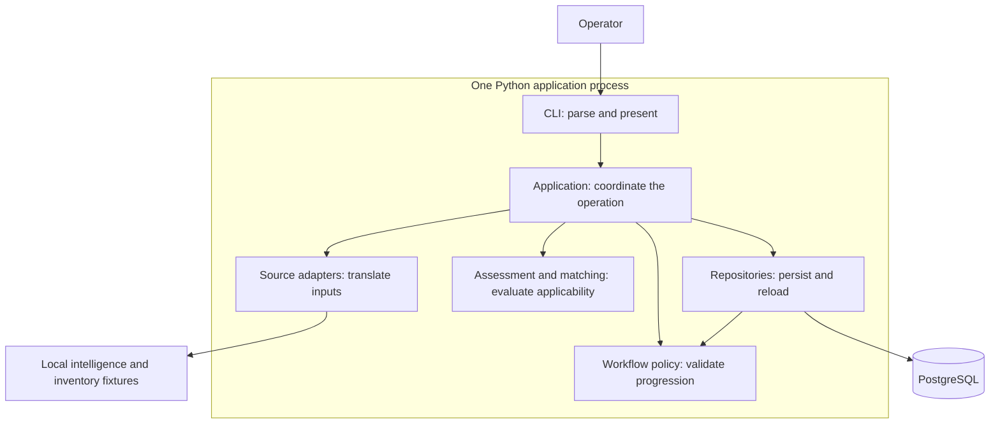
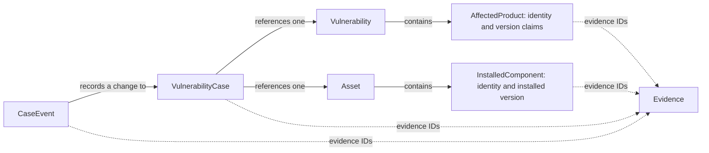
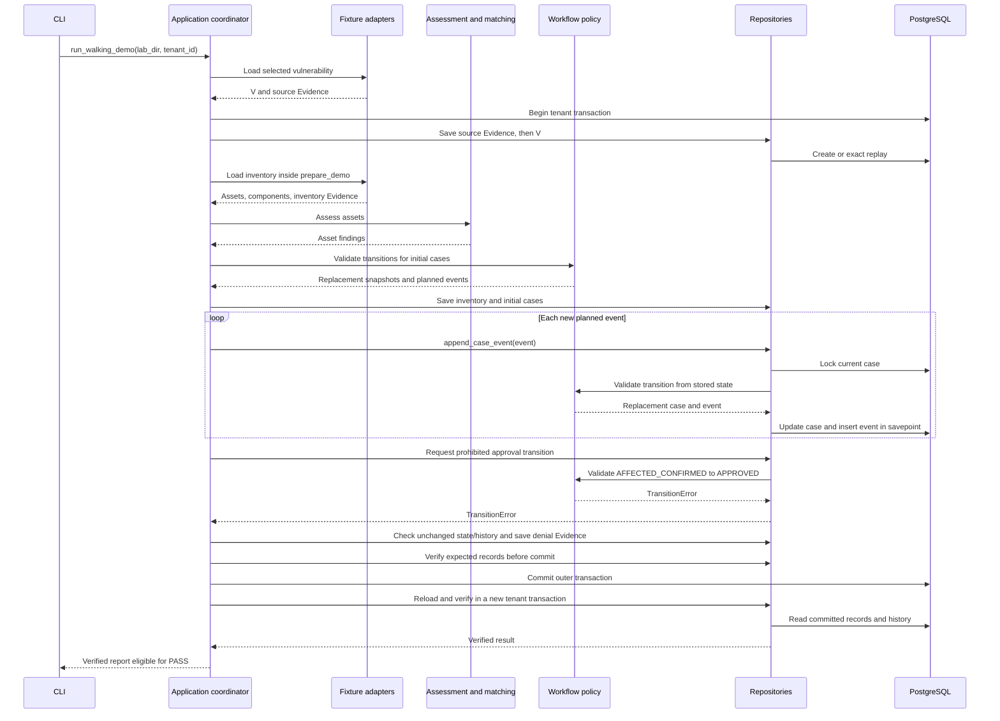
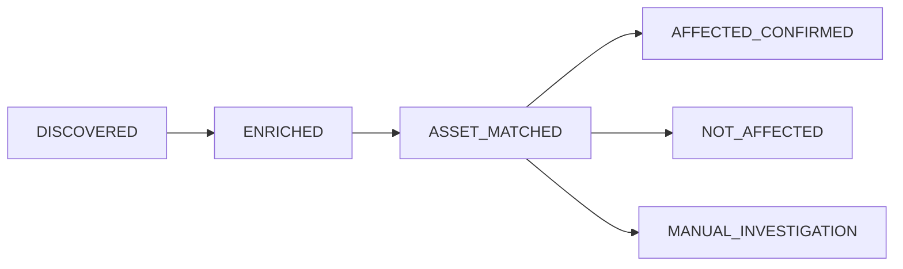

# VulnOps: Architecture & Maintenance Walkthrough

This is the architectural starting point for engineers maintaining the Day 1
foundation. It consolidates the earlier walkthrough and blueprint. Read sections
1–4 in order to establish the system model; sections 5–7 use that model to explain
correctness, diagnosis, and safe evolution. Commands and reference material are
in the appendices.

The implementation defines current behaviour. ADRs record why decisions were made
and how they changed. This guide connects those two views; it does not replace the
[invariants](invariants.md), [decision ledger](day01-decision-ledger.md), or
[security review](day01-security-review.md).

## 1. The business outcome and the system boundary

A vulnerability announcement does not equal enterprise risk.

The security team receives a statement about software, but must make decisions
about its own infrastructure. It needs to determine which assets are affected,
prioritise their treatment, carry out permitted remediation, and establish that the
remediation worked. Each decision needs an explanation that survives staff changes,
retries, and process failures.

VulnOps is the control plane for that work: it connects intelligence to enterprise
assets and governs the recorded lifecycle. The eventual V1 outcome is **verified
remediation**. Day 1 builds the foundation: **evidence-supported applicability,
independent asset cases, controlled progression, and durable history**.

Throughout this guide we use one actual lab fixture, the fictional
[CVE-2099-900001](../lab/fixtures/vulnerabilities/CVE-2099-900001.json). It reports
that Lab Web is affected from version 1.0.0 until the fixed release 2.0.0. Inventory
reports Lab Web 1.4.0 on web-01, 2.0.0 on web-02, and no version on legacy-01.
Those assets need different outcomes even though they share the same advisory.

The architecture follows directly from that need:

| Business requirement | Consequence for the design |
| --- | --- |
| Explain an asset's assessment | Preserve the source observations and reference them from conclusions |
| Accept different intelligence and inventory formats | Translate inputs into common internal models |
| Make independent decisions for different assets | Track a case for each relevant vulnerability/asset pair |
| Avoid clearing assets on incomplete information | Preserve UNKNOWN rather than defaulting to safe |
| Govern work and reconstruct its progress | Validate lifecycle transitions and retain their events |
| Continue after the application exits | Store authoritative records in PostgreSQL |

Day 1 implements these consequences using synthetic fixtures. It has no live-feed
scheduler, agent runtime, LangGraph dependency, model memory, production executor,
or actual patch-validation service. Later lifecycle states and optional references
are declared contracts for future work, not evidence those services exist. The lab
containers are inert stand-ins, not real vulnerable installations.

Keep three responsibilities in mind: **sources report, rules interpret, and the
application records controlled work**. PostgreSQL is authoritative for what the
system has committed. That does not make a stored source claim factually true.

We can now place those responsibilities in the running application.

## 2. The whole application: a coordinator with rules and adapters

VulnOps currently runs as **one Python process connected to PostgreSQL**. A command
starts the process, performs an operation, and exits. Source adapters, application
services, matching, workflow, and repositories are modules inside that process.
They are not independent network services or agents.

### Runtime collaboration



Arrows mean **invokes or accesses**, not data ownership or chronological order.
Return values are omitted. Domain models are the values exchanged between these
modules; they are not another running service. Application composition also opens
and commits the tenant transaction.

The **application coordinator** is the organising centre. It chooses the sequence
of source loading, assessment, case planning, persistence, and verification. In the
persisted demo, this responsibility is split between composition in
[bootstrap.py](../src/vulnops/application/bootstrap.py) and the use-case functions in
[walking_skeleton.py](../src/vulnops/application/walking_skeleton.py). The CLI invokes
that operation and presents its result.

The two rule modules answer different questions. Assessment asks what the supplied
product/version claims imply for an asset. Workflow asks whether a requested case
transition is permitted. Both can operate without PostgreSQL. Repositories invoke
workflow policy again when applying a change to the stored case; a plan calculated
in memory does not override authoritative current state.

Adapters handle differences at the edges. Source adapters understand external field
names and produce domain values. Repositories understand SQLAlchemy/PostgreSQL and
return domain values. Keeping those responsibilities at the edges allows business
rules to be tested without a feed, a database connection, or a model provider.

### Code dependencies and the boundaries they preserve

The runtime diagram is not an import graph. These are the important dependencies
in the current code:

| Code area | Depends on | Boundary preserved |
| --- | --- | --- |
| `cli.py` | Application entry points and presentation/error types | Command handlers do not implement matching or lifecycle policy |
| `application/` | Source implementations, rules, domain values, repositories and session composition | Coordinates a complete operation and its transaction |
| `sources/` | Source schema parsing and domain models | Downstream rules do not inspect source dictionaries |
| `matching/`, workflow transition policy | Domain values and shared enums | Evaluation does not perform database writes or call an LLM |
| `persistence/` | Domain values, workflow policy, SQLAlchemy | Stored changes obey policy; ORM records stay inside persistence |
| `domain/` | Pydantic and domain/shared types | Source formats, ORM sessions, and orchestration are excluded |

These are selected dependency directions, not a claim of complete package isolation.
For example, the case model imports CaseState from `workflow/states.py`. Application
composition currently imports concrete fixture and PostgreSQL implementations.
The source protocol and demo/inspection repository protocols supply selected seams;
not every collaborator has a generic plug-in interface.

The source seam is explicit. [VulnerabilitySource](../src/vulnops/sources/base.py)
returns canonical vulnerability records with their Evidence. Its actual declaration is:

```python
@runtime_checkable
class VulnerabilitySource(Protocol):
    def fetch(self) -> Iterable[SourcedVulnerability]:
        """Return canonical observations plus the evidence needed to persist them."""
        ...
```

The returned envelope separates the normalized record from the observations that
support it. Replacing fixtures with a live source can preserve this contract;
retrieval, freshness, and update reconciliation still require additional work.

This map tells us where behaviour belongs. To understand what passes between the
parts, we next need the domain model.

## 3. The domain model: two descriptions joined into one operational case

The enterprise question has two sides. A vulnerability describes a software problem
and the products/releases it reportedly affects. An asset describes an enterprise
resource and its reported installations. Neither side alone identifies an affected
enterprise asset.

### Relationships before fields



Solid arrows are the labelled business relationships. Dotted arrows are provenance
references. This is a conceptual view, not a database schema; additional evidence
references on assets, vulnerabilities, and scoring observations are omitted.

**Vulnerability** groups source claims about a disclosed problem. Its internal UUID
is separate from its optional CVE identifier. An **AffectedProduct** groups one
ProductIdentity, its VersionConstraints, and applicability evidence. ProductIdentity
supports PURL, CPE, ecosystem/package, and names. VersionConstraint represents exact,
introduced, last-affected, and fixed boundaries with a declared scheme and source
status. The representations retain a source's meaning; comparison belongs to rules.

In our fixture, this grouping means: the package `pkg:pypi/vulnops-lab-web`, affected
from 1.0.0, fixed in 2.0.0, under explicit `semver`. If the CVE names a second product
with a different fix, it gets another AffectedProduct. A single vulnerability-wide
fixed-version field would lose that association.

**Asset** holds enterprise context such as production environment, exposure,
business criticality, and owner. **InstalledComponent** holds one reported
installation, its owning asset ID, product identity, version, discovery information,
and evidence. web-01 contains Lab Web 1.4.0 and Lab Common 1.0.0. An asset's criticality
is distinct from a vulnerability's severity; an owner label is distinct from approval
authority. VulnOps consumes minimal inventory snapshots rather than becoming a CMDB.

### From claims to findings

**Evidence** is an independently identified, attributable observation. It preserves
what a source said, about which subject, and when it was observed. The adapter also
retains source location and exact-file hash. A UUID makes a claim referenceable;
a hash identifies bytes. Neither establishes source truth or freshness.

The canonical Vulnerability and Asset make those observations computable. They
reference Evidence so later interpretation remains traceable to its source. This
is why some information appears both in a structured field and in source content:
the rule needs a structured range, while a reviewer needs its original basis.

**AffectedResolution** interprets one component/product pair. **AssetAssessment**
combines those pair findings for the whole asset, retaining comparisons, reasons,
methods, provenance, and completeness/candidate information. These are computed
objects, not extra database tables. The demo retains serialized assessment details
in an event reason, alongside the case's status and evidence references.

CVSS, KEV, and EPSS remain separate observations on the vulnerability. Severity,
catalog membership, and a dated forecast provide different context. None supplies
an installed version or directly determines an asset's risk priority today.

### From a finding to tracked work

A **VulnerabilityCase** connects one vulnerability to one asset, unique within the
tenant. It lets web-01, web-02, dev-01, and legacy-01 retain different outcomes and
progress without changing the shared advisory record.

The case has two independent axes:

| Field | Question it answers | web-01 at creation in this demo |
| --- | --- | --- |
| `affected_status` | What did assessment conclude? | AFFECTED |
| `state` | Which lifecycle stage is recorded? | DISCOVERED |

The demo computes assessment before constructing the case. It then records workflow
progress. Priority and plan/approval/verification references remain unset. An optional
UUID is a structural hook, not an authenticated approval or completed verification.

A **CaseEvent** records a lifecycle change: old/new state, actor, reason, time,
evidence, and correlation ID. Current case state and historical events have different
jobs. Updating the current snapshot must not rewrite the earlier explanation.

We now have the static structure and business relationships. The next section follows
those same collaborators and objects through one invocation.

## 4. Execution: from the selected fixture to committed readback

We will follow CVE-2099-900001 and web-01. For readability, **V** means its canonical
vulnerability, **A** means the web-01 asset, **C** means the case for V × A, and
**E-advisory/E-inventory** mean their supporting observations. These are teaching
labels for UUID-backed records, not IDs accepted by the CLI.

### The complete operation



Here arrows mean ordered calls/results. The diagram groups helpers by architectural
responsibility and omits repeated exact saves and individual readback calls. This is
the successful operation, including its required policy denial; any unexpected
validation, write, commit, or verification failure prevents PASS.

### Translate and preserve the inputs

The CLI dispatches `demo` to `run_walking_demo`. `load_demo_vulnerability` selects
one CVE through FixtureVulnerabilitySource. The adapter parses its supported
OSV-like subset, computes a SHA-256 digest of exact source bytes, attributes the
observations, and returns V plus four source/enrichment Evidence records.

The application opens a tenant transaction and saves Evidence before V, because
V's references must resolve. These writes are not committed yet. This ordering is
visible in the actual composition code:

```python
        with tenant_session(engine, tenant_id) as session:
            repository = Repositories(session, tenant_id)
            for evidence in source.evidence:
                repository.save_evidence(evidence)
            repository.save_vulnerability(source.vulnerability)
            plan = prepare_demo(lab_dir, source=source)
            blocked = persist_demo(repository, plan)
            verify_demo(repository, plan, blocked, tenant_id)
```

The source is already translated before this excerpt. `prepare_demo` then loads
inventory, computes assessments, and plans cases/events. `persist_demo` applies that
plan through repositories. The context in
[bootstrap.py](../src/vulnops/application/bootstrap.py) commits only when its body
finishes successfully; the function then verifies committed data in another context.

### Evaluate the installation, then the asset

The inventory adapter returns A, its installations, and E-inventory. The application
passes V, A, and resolved evidence into `assess_asset`. That boundary revalidates
complete snapshots and ownership before comparing each component with each affected
product. It rejects unresolved provenance and conflicting contents for one evidence ID.

For A's Web installation, product identity matches the advisory PURL. The version
matcher uses numeric release tuples to evaluate
`(1, 0, 0) <= (1, 4, 0) < (2, 0, 0)`. Introduced is inclusive and fixed is exclusive.
The pair finding is AFFECTED, with E-advisory and E-inventory references.

For A's Common installation, the structured product is different. That pair returns
NOT_AFFECTED. It excludes Common from this product claim; it does not cancel Web's
positive or clear the whole asset.

Asset aggregation checks uncertainty first. No comparisons or any UNKNOWN comparison
produce UNKNOWN. Otherwise a supported positive produces AFFECTED. Otherwise, all
exclusions require explicit asset-scoped complete-inventory evidence to produce
NOT_AFFECTED; without it the result is UNKNOWN. A listed component can still have an
unknown version, so component-list completeness does not resolve legacy-01.

There are two scopes to remember. Within one pair's version ranges, a supported
positive can survive an unsupported sibling range unless an explicit exemption
conflicts. Across component/product comparisons, asset policy preserves any UNKNOWN,
even alongside a positive. The retained comparisons show why. Confidence is never
a vote that erases uncertainty.

### Plan the case and its permitted progression

`prepare_demo` creates C with AFFECTED assessment and DISCOVERED state, then uses the
pure transition service to plan ENRICHED, ASSET_MATCHED, and AFFECTED_CONFIRMED. It
returns new snapshots and CaseEvents without database writes. C's correlation ID,
event IDs, reasons, and logical times are stable for exact replay.



These are the demo's executed edges, not the complete lifecycle graph. Later stages
and alternate paths are defined in `ALLOWED_TRANSITIONS`; their services remain
outside this implementation. The ASSET_MATCHED event reason carries the assessment.
The demo uses SYSTEM actor `vulnops-day1-demo-v1` and fixture time
`2026-10-25T08:00:00Z` plus one second per step, not actual runtime elapsed time.

Candidate selection prevents unrelated structured products from generating cases.
For this selected CVE, API/database assets are stored inventory but non-candidates.
The final candidate cases are:

| Asset | Assessment | Final recorded state | Basis |
| --- | --- | --- | --- |
| web-01 | AFFECTED | AFFECTED_CONFIRMED | Web 1.4.0 is inside the range; other pair is excluded |
| web-02 | NOT_AFFECTED | NOT_AFFECTED | Web 2.0.0 is at the fixed boundary; complete inventory supports all exclusions |
| dev-01 | AFFECTED | AFFECTED_CONFIRMED | Development context does not change applicability |
| legacy-01 | UNKNOWN | MANUAL_INVESTIGATION | Missing version blocks supported comparison |

### Apply the plan and prove it survived commit

`persist_demo` saves inventory evidence/assets, creates missing DISCOVERED cases,
and appends planned events through repositories. For each new event, the repository
locks the current stored case and revalidates the edge. The result is still subject
to the current database state, regardless of what the plan expected.

The demo also requests C's forbidden AFFECTED_CONFIRMED → APPROVED transition. It
requires that specific edge denial, checks unchanged state/history, and explicitly
saves SYSTEM Evidence of the attempt. There is no generic denied-operation logger.

After exact pre-commit checks, the outer transaction commits. A new tenant transaction
reloads and compares source records, assets, cases, evidence, and histories. Only
then does the CLI emit JSON, the blocked-edge line, and `DAY-1 ACCEPTANCE: PASS`.
The result is one vulnerability, six assets, twelve components, four cases, twelve
CaseEvents, and eleven Evidence records. These are fixture counts, not a universal
schema requirement.

The successful execution connects the architecture to the business outcome: the
team can inspect distinct asset conclusions and trace their permitted progression.
To maintain that outcome under failure, we need to understand what persistence and
policy actually guarantee.

## 5. Correctness depends on preserving the boundaries

The normal path alone cannot guarantee a coherent case. We must also preserve its
meaning when inputs are malformed, workers are stale, or one write fails.

### Validation establishes a usable record, not truth

Strict Pydantic domain contracts reject unexpected fields, invalid identifiers,
naive timestamps, and invalid scores. Evidence requires nonblank attribution;
optional internal source URIs can be absent. Source-specific metadata remains
extensible. Python inputs and JSON decoding have different native representations
for UUIDs/enums/dates, so adapters must translate deliberately.

Validated source containers still contain mutable lists. At assessment entry, full
Asset/Vulnerability/Evidence snapshots are revalidated. This catches foreign-asset
component injection, cleared nested provenance, and conflicting contents for one
evidence UUID. The [security review](day01-security-review.md) records the actual
bug behind this boundary. Revalidating a component alone cannot establish its
relationship to the containing asset.

Identity/version rules then limit what can be concluded. Structured identifier
conflicts remain UNKNOWN; aliases do not establish fuzzy equivalence. Name-only
matching cannot justify a definitive version-based exclusion. Ordering supports
explicit plain three-part SemVer, with numeric comparison; prereleases, build
metadata, epochs, suffixes, and unsupported schemes remain UNKNOWN. Literal exact
equality is supported without a scheme, but unequal opaque strings cannot prove
exclusion. An unknown fixed version does not clear a supported affected range.

### Lifecycle policy protects progression

The sole edge mapping is `ALLOWED_TRANSITIONS`. The pure transition service checks
expected state, edge, actor, reason, evidence, time, and target prerequisites. It
returns a replacement case/event pair. Frozen case objects discourage ordinary
assignment, but they are not a sandbox against trusted bypass methods or raw SQL.

The repository applies this policy to the locked stored case. Its actual boundary is:

```python
        with self._session.begin_nested():
            row = self._locked_case(case_id)
            result = validate_transition(case=_decode(VulnerabilityCase, row.payload), **request)
            return self._store_transition(row, result)
```

`_store_transition` resolves case evidence, compares old state/revision in the UPDATE,
and inserts the event with the next sequence. The nested transaction is a savepoint:
if insertion fails after the UPDATE, neither part of that transition survives, even
if the outer caller catches the exception. The outer transaction still controls
final commit. `append_case_event` applies the same policy for new historical entries;
it accepts identical replay and rejects replacement content under an existing ID.

### Persistence keeps identity, context, and history aligned

PostgreSQL stores JSONB domain snapshots with relational identities, constraints,
revision/sequence columns, and lookup fields. SQLAlchemy records remain inside
persistence; repositories revalidate and return domain objects. This trades mapping
and migration work for an ORM-independent business model. The table mapping is in
Appendix A.

Every operation uses an explicit tenant transaction. `tenant_session` sets
transaction-local `app.current_tenant_id`; repository construction requires matching
session context. Queries also filter tenant IDs, references use tenant-aware keys,
and forced RLS applies database isolation. Runtime credentials differ from migration
owner credentials. Authentication of the caller choosing tenant/actor is still a
future boundary; RLS does not authenticate a HUMAN enum or a CLI argument.

Saves create or exactly replay snapshots. A CVE or namespaced external asset ID can
resolve to an existing canonical identity; callers must use returned objects.
Changed content raises RepositoryConflict. `save_case` only accepts new/replayed
DISCOVERED snapshots, not arbitrary progressed updates. There is no general refresh,
reopen, or assessment-update command.

Current case state is authoritative; history explains it. Normal APIs and runtime
grants prevent event UPDATE/DELETE, but database owners can still alter storage.
This is append-oriented audit, not a tamper-proof ledger or a database rebuilt from
events. Restart tests prove application-process durability, not backup restoration
or database-server disaster recovery.

These guarantees give us concrete diagnostic boundaries. A failed command is no
longer an undifferentiated “system error”: we can ask which boundary rejected it
and which transaction had reached commit.

## 6. Diagnose failures through the same architecture

Begin by recording the invoked command, selected tenant, code revision, fixture
snapshot, stderr/exit status, and any successful report. Inspect the case and its
history using the same tenant. Stable fixture timestamps are replay clocks, not
wall-clock execution logs; distinguish a previous committed run from a new attempt.

The CLI deliberately emits brief error messages. It does not expose a traceback,
structured diagnostic log, model trace, or orchestration checkpoint. A broad CLI
message may require a controlled reproduction at the named Python boundary to
inspect its actual exception. Do not invent certainty about rollback from an exit
code alone, and do not bypass isolation or policy to make a reproduction succeed.

| Symptom | Boundary to inspect | Diagnosis and response |
| --- | --- | --- |
| “Unable to load lab snapshot” | Fixture adapter / SourceError | Check `--lab-dir`, manifest, selected CVE, source DTO fields, and supported range events. The adapter rejects malformed/duplicate/orphan/conflicting supported records. Reproduce `fetch()` to locate the validation cause. |
| An asset is UNKNOWN | Identity/version rules and assessment | Inspect comparison methods/reasons, installed version, referenced observations, and completeness. UNKNOWN may be the correct result; repair missing evidence or implement tested semantics rather than force NOT_AFFECTED. |
| Ownership or provenance validation fails | `assess_asset`, then repository reference checks | Revalidate the complete asset and compare each component's asset ID; resolve all referenced evidence in the tenant. A UUID with foreign or nonexistent evidence is not sufficient. |
| A transition is denied or stale | Transition policy and repository state/revision | Compare requested expected state and target with stored case/history; check actor, reason, evidence and target prerequisites. Reread before making a new deliberate request; no automatic retry/recovery service exists. |
| A repeat run reports invalid input/configuration | Snapshot equality / RepositoryConflict | The CLI groups ValueError subclasses under one message. Compare current fixtures, source hashes, and existing cases/history. Changed content or independently progressed cases require reconciliation; do not delete history or reseed to hide the conflict. |
| A known record is absent or history is empty | Inspection tenant and identity | Confirm tenant and internal UUID, then the successful ingestion context. CLI not-found is intentionally not proof that a record exists in another tenant. Keep RLS and tenant filters enabled. |
| “Database operation failed” | Engine configuration, migration and runtime role | Check local service readiness, database URLs, applied migration and role grants. Migration owner and runtime role serve different purposes. The generic SQLAlchemy error does not identify the exact cause; use controlled exception inspection. |
| Demo exits without PASS | Pre-commit gate or committed readback | Compare expected cases/history through a fresh inspection transaction. Before-commit failure rolls the operation back; post-commit verification failure leaves records committed. Earlier runs may also explain existing rows. See the readback failure test below. |

### Follow one diagnosis to its cause

Suppose web-02 unexpectedly becomes UNKNOWN while the pair finding still excludes
its fixed version. Follow the model from section 3: a pair exclusion is not an asset
negative. Inspect AssetAssessment's `inventory_complete` and asset-scoped Evidence.
If completeness is absent, policy intentionally refuses a whole-asset negative.
The relevant code is `assess_asset`, not the SemVer comparator or the state machine.
`test_missing_completeness_never_turns_exclusion_into_unaffected` in the
[assessment tests](../tests/application/test_assessment.py) demonstrates the outcome.

For a storage failure, follow section 4's commit boundary. The regression
`test_event_insert_failure_rolls_back_state_even_if_caller_handles_error` in
[the persistence tests](../tests/integration/test_persistence.py) injects audit-insert
failure and proves the transition leaves neither updated state nor an event.
`test_post_commit_readback_failure_never_prints_pass` in
[the demo integration tests](../tests/integration/test_walking_skeleton.py) proves
the different post-commit case: records remain but PASS is suppressed.

There are no current hallucination or agent-loop diagnostics to operate. If a future
model is involved, first separate its proposal from source evidence and authoritative
commands. Adding such a runtime also requires its own bounded execution and
observability design; existing event history is business history, not model memory.

## 7. Evolve the system by changing the responsible boundary

The architecture map tells us where a change belongs. Use it before selecting an
agent framework or copying logic into a new interface. Preserve the source → finding
→ controlled-work distinction and test the observable capability across boundaries.

| Desired change | Existing seam and additional work | Contract to preserve |
| --- | --- | --- |
| Add CVE, CISA KEV, EPSS or vendor input | Implement source-specific translation into canonical records/Evidence; compose an explicit application ingestion operation. The demo is not that general operation. Define retrieval time, validation, source suitability, retention and refresh/reconciliation. | Downstream matching stays source-independent. Missing enrichment is absent, not a fabricated negative. Separate CVSS/KEV/EPSS observations remain attributable. |
| Support another version scheme | Extend `version_matcher` under an explicit scheme with ecosystem fixtures and boundary tests. Product identity support alone is not version-ordering support. | Unsupported semantics remain UNKNOWN. Preserve pair/asset scope and conservative completeness rules. |
| Add prioritisation | Introduce explicit asset-context policy and an authorised, audited application update. Current `priority=None` and progression prerequisites are hooks, not an implemented scorer. | Severity alone is not enterprise risk; a probabilistic output cannot directly assign authoritative priority. |
| Refresh observations or reassess cases | Design versioned reconciliation and a specific assessment-update/reopen command. Define treatment of old evidence, histories, conflicts, and changed context. Existing save methods intentionally conflict. | Preserve prior explanations and case identity. Do not reset cases or rewrite old events. |
| Add an operator console | Reuse or extend application operations; establish authenticated tenant/actor context before remote/multi-user use. | No second copy of matching/lifecycle rules in HTTP/UI handlers. CLI tenant selection is not authentication. |
| Add AI assistance or orchestration | Introduce advisory proposals or coordination around application commands, with source references, bounded operation and observability. No agent runtime currently exists. | Checkpoints are execution context, not case authority. Do not give models raw sessions, write credentials, or arbitrary host execution. |
| Add production execution | First establish immutable action specifications, authenticated human approval bound to exact actions, registered constrained tools, shared default-deny dispatch/kill switch, verification and rollback. | Approval UUIDs and later state names alone grant no authority. Recheck policy at the actual side-effect boundary. |

The [Day 2 handoff](day02-handoff.md) identifies exact observation fields and current
CVE/KEV/EPSS/vendor mapping examples. New source coverage must add representative
fixtures and adapter tests. New version policy must add positive, negative,
unsupported and contradictory cases. New application commands must add evidence,
tenant, transition, durability and retry tests appropriate to their effects.

Deprecation also crosses boundaries. Before removing a field, source, or component,
identify its consumers, public commands, persisted JSONB snapshots, and historical
events. Specify compatibility and migrations so old records remain inspectable.
Change orchestration or interface code without transferring business authority.
A material reversal needs a new ADR identifying the superseded decision and the
migration implications.

The [eight acceptance scenarios](../tests/acceptance/test_day01.py) are the minimum
cross-layer regression boundary: affected with evidence, supported not-affected,
unknown/investigation, observable illegal-transition denial, rejected missing/foreign
provenance, fresh-process durability, exact replay, and independent asset outcomes.
They use real PostgreSQL. Mock-only green tests cannot establish those guarantees;
missing database configuration must fail acceptance rather than silently skip it.

The important trade-offs are now visible in context: explicit mappings cost code,
UNKNOWN costs investigation, cases cost records, PostgreSQL costs operations, and
atomic audit costs transaction design. In return, the system can explain and govern
asset-specific work. The [ledger](day01-decision-ledger.md) records the detailed
alternatives, confidence and revisit triggers instead of repeating them here.

## Appendix A. Code and storage reference

Use these locations after understanding the diagrams. They are a navigation index,
not additional architectural layers.

| Concern | Implementation |
| --- | --- |
| Evidence and attribution | [domain/evidence.py](../src/vulnops/domain/evidence.py) |
| Canonical vulnerability and CVSS/KEV/EPSS observations | [domain/vulnerability.py](../src/vulnops/domain/vulnerability.py) |
| AffectedProduct and ProductIdentity | [domain/product.py](../src/vulnops/domain/product.py) |
| VersionConstraint and source version status | [domain/version.py](../src/vulnops/domain/version.py) |
| Asset and InstalledComponent | [domain/asset.py](../src/vulnops/domain/asset.py) |
| VulnerabilityCase, AffectedStatus and exposure | [domain/case.py](../src/vulnops/domain/case.py) |
| Source protocol/envelopes and fixture translation | [sources/base.py](../src/vulnops/sources/base.py), [sources/fixtures.py](../src/vulnops/sources/fixtures.py) |
| Identity, versions and pair findings | [product_matcher.py](../src/vulnops/matching/product_matcher.py), [version_matcher.py](../src/vulnops/matching/version_matcher.py), [affected_resolver.py](../src/vulnops/matching/affected_resolver.py) |
| Asset findings and application planning | [assessment.py](../src/vulnops/application/assessment.py), [walking_skeleton.py](../src/vulnops/application/walking_skeleton.py) |
| Composition and inspection | [bootstrap.py](../src/vulnops/application/bootstrap.py), [inspection.py](../src/vulnops/application/inspection.py) |
| Lifecycle states, events/actors and policy | [states.py](../src/vulnops/workflow/states.py), [events.py](../src/vulnops/workflow/events.py), [transitions.py](../src/vulnops/workflow/transitions.py) |
| ORM models, transactions and repository commands | [models.py](../src/vulnops/persistence/models.py), [session.py](../src/vulnops/persistence/session.py), [repositories.py](../src/vulnops/persistence/repositories.py) |
| Table constraints, RLS and grants | [0001_day1_persistence.py](../alembic/versions/0001_day1_persistence.py) |

The six tables are `vulnerabilities`, `assets`, `installed_components`, `evidence`,
`vulnerability_cases`, and `case_events`. Affected products/ranges and scoring
observations are nested in vulnerability snapshots. Assets store their context,
while ordered component rows are reconstructed into the Asset domain model. Case
rows contain current state/revision; event rows have immutable domain payloads and
per-case sequence. Evidence UUID arrays are resolved by application/repository
checks, not universal database foreign keys on every provenance reference.

The strict models use UUID identities and timezone-aware timestamps. Source
VersionStatus describes a claim; AffectedStatus describes assessment. Missing values
stay explicit. Source schema version identifies the primary input format; other
source schema details belong in their Evidence metadata.

## Appendix B. Run, inspect, and reproduce the example

Use the [README's local setup](../README.md#local-postgresql-and-integration-tests)
to sync dependencies, configure ignored `.env`, start PostgreSQL and apply migrations.
Use a dedicated local/test database. The tracked example contains public loopback
lab defaults, not production credentials. Application runtime uses DATABASE_URL;
Alembic uses the separate migration-owner URL.

```bash
export VULNOPS_TENANT_ID=d383a693-f08c-504b-bf7e-d7008885b119
uv run --env-file .env --locked vulnops demo
uv run --env-file .env --locked vulnops vulnerability show CVE-2099-900001
uv run --env-file .env --locked vulnops asset list
uv run --env-file .env --locked vulnops case list
uv run --env-file .env --locked vulnops case show 0ad1e3cb-e2a7-5357-a954-f84856de1415
uv run --env-file .env --locked vulnops case history 0ad1e3cb-e2a7-5357-a954-f84856de1415
```

The tenant is the dedicated demo tenant and the case UUID is C for this unchanged
fixture. Other assets/cases use internal UUIDs returned by list commands. Set
`--tenant-id <uuid>` before the resource command as an alternative to the environment
variable. Lists support limit/offset; default limit is 100, maximum 1000.

The demo writes synthetic state; the six inspection operations are read-only.
Its output is JSON followed by blocked-edge/PASS text, not a single JSON document.
JSON presentation escapes terminal controls in source content. Exit codes are 0 for
success, 1 for source/database/acceptance failure, 2 for argument/input/configuration
failure (including caught ValueError subclasses), and 3 for record-not-found.
A valid empty list/history succeeds. See section 6 before interpreting a failure.

To inspect the plan without a database, start `uv run --locked python` from the
repository root and run this complete example:

```python
from pathlib import Path
from vulnops.application.walking_skeleton import prepare_demo

plan = prepare_demo(Path("lab"))
asset = next(a for a in plan.assets
             if a.external_id == "vulnops-lab:asset-web-01")
assessment = next(a for a in plan.assessments if a.asset_id == asset.asset_id)
case = next(c for c in plan.cases if c.initial.asset_id == asset.asset_id)
print([c.status.value for c in assessment.comparisons])
print(case.initial.affected_status.value, case.initial.state.value)
print([e.to_state.value for e in case.history])
```

Expected output:

```text
['AFFECTED', 'NOT_AFFECTED']
AFFECTED DISCOVERED
['ENRICHED', 'ASSET_MATCHED', 'AFFECTED_CONFIRMED']
```

This is an in-memory plan, not proof of persistence. `uv run python lab/demo.py` is
another database-free preview across all five fixtures; it does not print persisted
Day 1 acceptance. The persisted demo neither starts Docker nor migrates implicitly.

Run the full regression suite with `uv run --env-file .env --locked pytest`, or the
three disjoint groups:

```bash
uv run --locked pytest -m 'not integration and not acceptance'
uv run --env-file .env --locked pytest -m 'integration and not acceptance'
uv run --env-file .env --locked pytest tests/acceptance/test_day01.py
```

Both test database URLs are required for complete acceptance. The historical
[closeout](day01-decision-ledger.md#closeout-verification-and-release) records 405
passing tests and demo PASS. That measurement is a foundation baseline, not proof
of unimplemented production capabilities or future source coverage.

## Appendix C. Current limitations and documentation discrepancies

The fixtures implement source-like subsets, not full live CVE/KEV/EPSS/vendor feeds.
They use stable IDs and logical observation times. Claims retain parsed source
content; exact fixture bytes are hashed and retained in the checkout. There is no
production raw-payload store, freshness/authenticity policy, scheduler, or generic
refresh/reconciliation. One optional KEV and one optional EPSS slot do not provide
complete multi-source or time-series history.

Historical ADRs describe the implementation at their decision point. ADR-006
replaces ADR-005's temporary NEW state, ADR-008 adds restricted comparison beyond
ADR-003's initial representation-only model, ADR-011 supersedes ADR-010's offline-only
demo, and ADR-012 adds assessment revalidation/nonblank attribution. Read those
changes as a decision sequence, not simultaneous contradictory specifications.

Two source docstrings still contain outdated deferral language:

| Location | Stale wording versus current implementation |
| --- | --- |
| `workflow.transitions.transition_case` | Calls database compare-and-set/atomic event persistence future boundaries. The pure function remains side-effect free, but Repositories already implements those persistence boundaries. |
| `domain.case.VulnerabilityCase` | Calls evidence existence/suitability a future application/persistence responsibility. Existence is already checked in assessment/repositories; source suitability remains deferred. |

These comment discrepancies remain in source because this task changes documentation
only. The guide follows executable behaviour and the later ADRs. No architectural
reversal is introduced. The [security review](day01-security-review.md) remains the
reference for source trust, authenticated caller authority, action-bound approvals,
mutation denial, external-effect idempotency, and stronger audit/recovery work.

## Reconstruct the architecture

Close this guide and work through four tasks:

1. Draw the CLI, application coordinator, source adapters, rules, repository and
   PostgreSQL. Explain which component owns order, legality, and durable state.
2. Trace V × A from source claims through component findings to C and its events.
   Identify the exact point where a plan becomes committed and how readback proves it.
3. Diagnose web-02 becoming UNKNOWN after losing completeness, then distinguish an
   audit-insert rollback from a failed post-commit verification. Locate the enforcing
   functions and regression tests.
4. Place a new live vendor adapter and an advisory AI mapping proposal in the system.
   Explain the new work required without giving either direct case or production
   authority.

Use the maps and source references to check your reconstruction. Being able to
explain those connections, failures, and change locations is the learning goal;
passing technical documentation checks alone cannot establish it.
