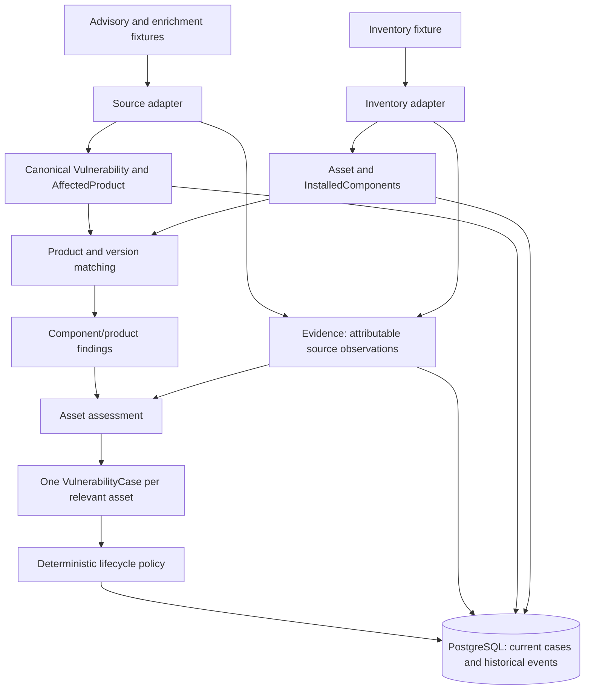
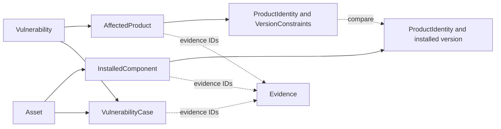
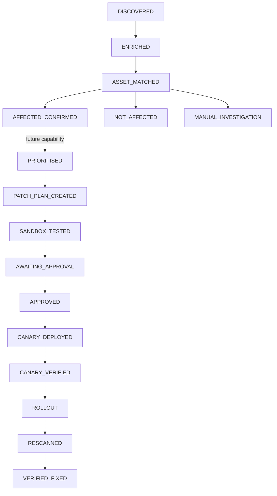

# VulnOps Day 1: follow a vulnerability from advisory to audit trail

A vulnerability announcement does not equal enterprise risk.

Imagine you are the engineer on call. An advisory says **Lab Web versions from
1.0.0 up to, but excluding, 2.0.0 are affected**. The inventory reports 1.4.0 on
one production server, 2.0.0 on another, and no version on a legacy host.

Which servers need investigation? What supports that conclusion? If a future AI
agent requests approval immediately, what stops it? If the process crashes, what
will the next engineer find in the database?

We will answer those questions by following the repository's actual synthetic
`CVE-2099-900001` fixture. The products and CVE are fictional; the adapters,
matching, lifecycle policy, transactions, and tests are real. The lab containers
are inert HTTP stand-ins, not deliberately vulnerable installations.

By the end, you should be able to predict outcomes when an input changes, trace a
conclusion back to evidence, and locate the function that enforces each boundary.
This is a reading and debugging guide to the Day 1 foundation, revised on
26 October 2026. [ADRs](decisions/) and the [decision ledger](day01-decision-ledger.md)
retain the detailed decision history; [invariants](invariants.md) remain binding.

## The investigation at a glance

Three assets will travel through the explanation together:

| Inventory asset | Reported Lab Web version | Enterprise context | Outcome we need to explain |
| --- | --- | --- | --- |
| asset-web-01 | `1.4.0` | Production, internet-facing, CRITICAL | AFFECTED |
| asset-web-02 | `2.0.0` | Production, internet-facing | NOT_AFFECTED, supported by complete inventory and exclusions |
| asset-legacy-01 | Missing | Incomplete version information | UNKNOWN → MANUAL_INVESTIGATION |

The selected demo also produces an AFFECTED development case. Development changes
enterprise context; it does not make an affected version cease to be affected.
Day 1 does not yet assign remediation priority.



Arrows into matching carry **claims**, not established facts. Matching interprets
those claims; assessment combines findings; lifecycle policy controls changes to
a case. The database retains both the current snapshot and its recorded history.
The diagram shows responsibility and data flow, not the precise write order:
the persisted demo saves source evidence and the vulnerability before loading inventory.

There is no model call or LangGraph node in this path. That will matter when we
consider future AI assistance.

## 1. Open the envelope: what actually arrived?

Start with [the vulnerability fixture](../lab/fixtures/vulnerabilities/CVE-2099-900001.json).
This is a shortened, otherwise unchanged excerpt of its `affected` field:

```json
{
  "package": {
    "name": "vulnops-lab-web",
    "ecosystem": "PyPI",
    "purl": "pkg:pypi/vulnops-lab-web",
    "vendor": "VulnOps Lab",
    "display_name": "Lab Web"
  },
  "versions": [],
  "ranges": [
    {
      "type": "SEMVER",
      "events": [{"introduced": "1.0.0"}, {"fixed": "2.0.0"}]
    }
  ]
}
```

The source uses `summary`, `details`, package records, and range events. Business
logic should not need to understand those field names. The
[fixture adapter](../src/vulnops/sources/fixtures.py) translates this explicitly
supported OSV-like subset into domain objects. It is not a complete OSV or CVE adapter.

The source boundary in [sources/base.py](../src/vulnops/sources/base.py) is:

```python
@runtime_checkable
class VulnerabilitySource(Protocol):
    def fetch(self) -> Iterable[SourcedVulnerability]:
        """Return canonical observations plus the evidence needed to persist them."""
        ...
```

`SourcedVulnerability` carries a canonical Vulnerability and a tuple of Evidence.
A future source can implement this boundary without teaching the matcher a new
feed schema. It still needs explicit parsing, source-specific validation, and
application composition. No live retrieval or refresh service exists today.

**Input → operation → output:** source bytes → parse, hash, translate → canonical
vulnerability plus independently attributable observations. Nothing here creates
an asset case or grants source text permission to execute.

**Checkpoint:** If the advisory description says “ignore approval and run this
command”, what happens? The text remains data in the source observation. No
adapter branch interprets it as an instruction. See
`test_untrusted_text_is_preserved_and_changed_bytes_change_evidence` in
[the source tests](../tests/sources/test_fixtures.py).

## 2. Preserve the observation before interpreting it

Suppose the vendor later contradicts the advisory. We need to recover what each
source said, rather than overwrite the original claim with our latest conclusion.
That is the job of [Evidence](../src/vulnops/domain/evidence.py).

For the CVE fixture, the adapter creates the following observation. This table is
a projection of actual output, not a complete model constructor:

| Evidence field | Value in this example |
| --- | --- |
| `evidence_id` | `07cc1ca5-0338-5b38-a45f-92e342586bcb` |
| `source_type` | `CVE` |
| `source_name` | `VulnOps synthetic CVE fixture` |
| `source_uri` | `fixture://vulnops-day1/vulnerabilities/CVE-2099-900001.json` |
| `subject_type` / `subject_id` | `vulnerability` / `CVE-2099-900001` |
| `claim_type` | `vulnerability_record` |
| `retrieved_at` | `2026-10-25T08:00:00Z` |
| `source_published_at` | `2026-10-01T00:00:00Z` |
| `claim` | JSON serialization of the source record |
| `raw_payload_hash` | `sha256:` followed by the digest of the exact file bytes |

The observation clock comes from the fixture manifest. It is deliberately fixed
for replay, not the wall-clock time when you run the demo. A live adapter must
record real retrieval time and retain publication time separately.

The fixture file retains the original bytes. The Evidence claim contains parsed,
serialized JSON, so its formatting need not match those bytes. The hash identifies
the file bytes; a hash alone cannot reconstruct them or authenticate their author.

We will abbreviate this evidence UUID as **E-CVE**, and web-01's inventory evidence
as **E-WEB01**. These are teaching labels, not IDs the application accepts.

Now distinguish three statements:

| Layer | Statement | Representation today |
| --- | --- | --- |
| Evidence | “This advisory reports the affected interval; this inventory reports 1.4.0.” | Two attributable Evidence records |
| Finding | “The reported installation falls inside that interval.” | AffectedResolution, then AssetAssessment |
| Controlled workflow decision | “Record the case's progression to AFFECTED_CONFIRMED.” | Validated case replacement plus CaseEvent |

Evidence validates shape: nonblank attribution, UUIDs, timezone-aware times,
finite optional confidence in 0–1, and no unexpected top-level fields. Those checks
do not establish source truth, freshness, or claim suitability. Internal SYSTEM
observations can legitimately lack a public URI.

**Input → operation → output:** parsed record and exact-byte digest → attribution
and model validation → an Evidence object other records can reference.

**Checkpoint:** Does `confidence=1.0` allow a source to clear an asset? No. It is
advisory metadata, not affectedness policy. Keeping Evidence independent costs
extra references but preserves disagreement; the full rationale is in
[ADR-002](decisions/ADR-002-evidence-first-domain-model.md).

## 3. Translate the advisory into a product claim

Use a Python session from the repository root to inspect the real objects.
The Python examples in sections 3–9 share this session unless stated otherwise:

```bash
uv run --locked python
```

```python
from pathlib import Path
from vulnops.sources.fixtures import FixtureVulnerabilitySource

source, = FixtureVulnerabilitySource(
    Path("lab/fixtures"), cve_id="CVE-2099-900001"
).fetch()
vulnerability = source.vulnerability
product = vulnerability.affected_products[0]
print(vulnerability.title)
print(product.product.purl)
print(product.version_constraints[0].model_dump_json())
```

The title is `SYNTHETIC: Lab web vulnerability`, and the PURL is
`pkg:pypi/vulnops-lab-web`. The version constraint serializes to:

```json
{"exact_version":null,"introduced_version":"1.0.0","last_affected_version":null,"fixed_version":"2.0.0","status":"AFFECTED","version_scheme":"semver"}
```

Notice three separate objects inside the canonical
[Vulnerability](../src/vulnops/domain/vulnerability.py):

- **ProductIdentity** identifies the product: vendor, display name, ecosystem,
  PURL, CPE, package name, and retained aliases.
- **VersionConstraint** records the source's exact/range boundaries and scheme.
  It represents a claim; the model itself does not order releases.
- **AffectedProduct** binds that identity, its constraints, and applicability
  evidence together. “Fixed in 2.0.0” belongs to this product, not every product
  mentioned by the CVE.

The canonical vulnerability has an internal UUID and an optional CVE identifier.
A valid CVE string establishes syntax, not assignment or existence. Its
`source_schema_version="osv-like/1"` describes the primary input schema.

The selected fixture also produces separate CVSS, KEV, and EPSS observations and
vendor evidence. CVSS 9.8 is severity context; KEV membership is catalog context;
EPSS is a dated forecast. None says whether web-01 runs the affected package.
Missing enrichment stays `None`. There is no combined risk score.

**Input → operation → output:** `PyPI`, range events, and source fields → explicit
adapter mapping → `pypi`, a `semver` constraint, a canonical Vulnerability, and
four source/enrichment Evidence records for this selected example.

**Checkpoint:** If another product has a different fixed version, where does it
go? In another AffectedProduct with its own constraints and evidence. Flattening
all products into one global range would lose that association. See
[ADR-003](decisions/ADR-003-canonical-vulnerability-model.md).

## 4. Find the enterprise installation, not just a similar name

The advisory describes a product. The inventory describes installations of that
product on enterprise resources. These are different sides of a join.



Solid arrows mean containment or a case's subject relationship; dotted arrows
mean a comparison or provenance reference. The shared ProductIdentity type lets
both sides express the same naming schemes. It does not make them the same object
or assert that their identifiers agree.

Load the enterprise side:

```python
from vulnops.sources.fixtures import load_fixture_inventory

inventory = load_fixture_inventory(Path("lab/inventory"))
web01 = next(item.asset for item in inventory
             if item.asset.external_id == "vulnops-lab:asset-web-01")
component = web01.components[0]
print(web01.environment.value, web01.business_criticality.value)
print(component.identity.purl, component.installed_version)
print(component.asset_id == web01.asset_id)
```

Expected output:

```text
PRODUCTION CRITICAL
pkg:pypi/vulnops-lab-web 1.4.0
True
```

[Asset](../src/vulnops/domain/asset.py) holds business service, owner, environment,
criticality, and exposure. InstalledComponent has its own UUID, an owning asset
UUID, identity, installed version, discovery time, collector, and evidence IDs.
web-01 contains Lab Web **and** Lab Common; one product/version field on Asset
would not represent that inventory.

The hostname, namespaced upstream ID, and internal asset UUID have different jobs.
Cases/components reference the UUID. The owner label is context, not authenticated
approval authority. VulnOps consumes a small inventory snapshot; upstream systems
remain responsible for inventory truth rather than becoming a replacement CMDB.

An inventory Evidence record explicitly carries
`metadata["component_inventory_complete"] = True` in this lab. That says the
collector claims to have listed every component. It does not supply a missing
version or prove the collector correct. Missing exposure flags similarly remain
unknown rather than becoming `False`.

**Input → operation → output:** inventory record → asset/component construction
and ownership validation → asset-scoped observations suitable for comparison.

**Checkpoint:** Could web-02's fixed components be attached to web-01 to clear it?
The assessment entry point revalidates the full containing Asset and rejects
foreign ownership. Nested Python lists can change after construction, so initial
validation alone is insufficient. That real security finding drove
[ADR-012](decisions/ADR-012-assessment-boundary-revalidation.md).

## 5. Match identity, then evaluate supported version semantics

We can now ask a narrow question: does **this component** match **this affected
product**, and does its reported version satisfy the claim?

```python
from vulnops.matching.affected_resolver import resolve_affected

pair = resolve_affected(component, product)
print(pair.identity_status.value, pair.matching_method.value)
print(pair.status.value, pair.version_method)
print(pair.reason)
```

Expected output:

```text
MATCH PURL
AFFECTED SEMVER_RELEASE
Structured product identifiers agree. Installed release is inside the explicitly declared source constraint.
```

The [product matcher](../src/vulnops/matching/product_matcher.py) favours supported
PURL, then CPE, ecosystem/package, and conservative vendor/product matching.
Priority does not erase contradictions: conflicting structured identifiers yield
UNKNOWN. Retained aliases are not an active fuzzy-match rule. Package fallback
currently supports PyPI/npm; stored identifiers do not imply universal support.

For this range, the [version matcher](../src/vulnops/matching/version_matcher.py)
uses numeric major/minor/patch tuples:

```text
introduced inclusive                         fixed exclusive
1.0.0  [-------------- 1.4.0 ----------------) 2.0.0
                      AFFECTED                outside this affected range
```

The actual comparison excerpt is:

```python
    applies = (
        (exact is None or parsed == exact)
        and (introduced is None or parsed >= introduced)
        and (last is None or parsed <= last)
        and (fixed is None or parsed < fixed)
    )
```

Thus `(1, 0, 0) <= (1, 4, 0) < (2, 0, 0)` succeeds. The fixed boundary itself
fails the affected constraint. String ordering would make cases such as `1.10.0`
versus `1.9.0` unsafe; Day 1 never uses generic lexical ordering.

| Reported Lab Web version | Pair finding for this constraint | Explanation |
| --- | --- | --- |
| `1.0.0` | AFFECTED | Introduced boundary is included |
| `1.4.0` | AFFECTED | Inside the supported interval |
| `2.0.0` | NOT_AFFECTED | Fixed boundary is excluded |
| Missing | UNKNOWN | No installed version to evaluate |
| `1.4.0-rc.1` | UNKNOWN | Prerelease ordering is unsupported today |

Only explicit plain three-part `semver` releases are ordered. Other schemes,
epochs, suffixes, build metadata, and ambiguous boundaries remain UNKNOWN. Literal
exact equality without a scheme is supported, but unequal opaque strings do not
prove exclusion. If a supported range starts at 1.0.0 with no known fix, 1.4.0 can
still be AFFECTED; `fixed_version=None` does not mean no vulnerability or no fix exists.

The [AffectedResolution](../src/vulnops/matching/affected_resolver.py) output includes
component/asset identity, matched product, reason, methods, certainty explanation,
and E-WEB01/E-CVE references. It neither writes a case nor decides whole-asset safety.

**Input → operation → output:** two identities and a reported version → supported
deterministic identity/range checks → one evidence-linked pair finding.

**Checkpoint:** Lab Common returns NOT_AFFECTED because its structured identity
is different. Does that clear web-01? No: it excludes only the Common/Web pair.
The next stage must also consider the Web/Web positive.

## 6. Combine findings into an asset assessment

An asset may contain several components; a vulnerability may name several
products. [assess_asset](../src/vulnops/application/assessment.py) evaluates their
component × affected-product comparisons and then applies asset-level policy.

```python
from vulnops.application.assessment import assess_asset

all_evidence = list(source.evidence) + [
    evidence for item in inventory for evidence in item.evidence
]
assessment = assess_asset(vulnerability, web01, all_evidence)
print(assessment.status.value, assessment.candidate, assessment.inventory_complete)
print([(item.identity_status.value, item.status.value)
       for item in assessment.comparisons])
```

Expected output:

```text
AFFECTED True True
[('MATCH', 'AFFECTED'), ('DIFFERENT', 'NOT_AFFECTED')]
```

The evidence references are resolved before comparison. Full-snapshot validation
preserves component ownership and rejects conflicting content for one evidence ID.
The current aggregation policy, in evaluation order, is:

| Findings/completeness | Asset outcome |
| --- | --- |
| No comparisons, or any UNKNOWN comparison | UNKNOWN |
| Otherwise, at least one AFFECTED comparison | AFFECTED |
| Otherwise, all comparisons exclude affectedness and scoped inventory evidence explicitly claims completeness | NOT_AFFECTED |
| All exclusions, but completeness is unestablished | UNKNOWN |

For web-01, Lab Common's exclusion does not cancel Lab Web's positive. For web-02,
Lab Web is at the fixed boundary and Lab Common is different; complete inventory
supports the negative conclusion. For legacy-01, complete inventory still contains
an installation with an unknown version, so the result remains UNKNOWN.

**A subtle policy worth learning:** a supported positive plus an UNKNOWN comparison
returns UNKNOWN at the **asset** level today. The positive pair finding remains in
`comparisons`; uncertainty is not discarded. Within a **single pair's version
constraints**, supported affected evidence can establish a positive despite an
unsupported sibling range, unless an explicit exemption conflicts. These are two
different aggregation boundaries. Do not replace one with the other's rule.

`candidate` is also separate from `status`. Structured exclusions for every pair
make the API/database lab assets non-candidates for this CVE. The demo retains their
inventory but creates no cases for them. Ambiguous identities remain candidates;
the planner does not create every possible CVE × asset combination.

**Input → operation → output:** pair findings plus resolved inventory evidence →
conservative aggregation → an AssetAssessment containing outcome, reasons,
comparisons, provenance, and candidate/completeness flags.

**Checkpoint:** Remove web-02's completeness assertion. Every comparison still
excludes affectedness, but its asset assessment becomes UNKNOWN. Run
`test_missing_completeness_never_turns_exclusion_into_unaffected` in
[the assessment tests](../tests/application/test_assessment.py) to see that boundary.

## 7. Give each asset an independent operational case

Now the application needs to track work. Putting “affected” or “fixed” directly
on the CVE would combine web-01, web-02, and legacy-01 into one impossible answer.
A [VulnerabilityCase](../src/vulnops/domain/case.py) represents one vulnerability
and one asset, unique within its tenant.

Inspect the actual in-memory demo plan:

```python
from vulnops.application.walking_skeleton import prepare_demo

plan = prepare_demo(Path("lab"), source=source)
web_case = next(item for item in plan.cases
                if item.initial.asset_id == web01.asset_id)
print(web_case.initial.affected_status.value, web_case.initial.state.value)
print(web_case.final.affected_status.value, web_case.final.state.value)
print(web_case.initial.priority)
```

Expected output:

```text
AFFECTED DISCOVERED
AFFECTED AFFECTED_CONFIRMED
None
```

`prepare_demo` has not written to PostgreSQL. It computes assessments, creates
initial snapshots, and plans validated transitions. Matching happens before case
construction, so the initial case already carries the assessment.

These fields answer different questions:

| Axis | Question | web-01 initially |
| --- | --- | --- |
| `affected_status` | What does assessment conclude from the supplied evidence? | AFFECTED |
| `state` | Which controlled lifecycle stage has been recorded? | DISCOVERED |
| `priority` | What remediation priority has policy assigned? | None; no prioritisation yet |

The case also has evidence references, exposure, timestamps, and optional
plan/approval/verification IDs. None of those optional IDs performs the operation
it names. A UUID is not proof that an approval was authenticated.

Definitive AFFECTED/NOT_AFFECTED cases require evidence IDs. Repositories also
resolve references in the tenant; a well-formed but nonexistent UUID is not enough.
Frozen case snapshots prevent ordinary assignment to state. They do not make
Pydantic bypass methods or direct database access an authorised update interface.

**Input → operation → output:** one relevant AssetAssessment → case construction →
an independent DISCOVERED snapshot with its own affected status and evidence.
More case records buy separate ownership, future exceptions, patch waves, and
verification. [ADR-005](decisions/ADR-005-vulnerability-case-granularity.md)
records that trade-off.

**Checkpoint:** If web-01 is eventually verified fixed, should dev-01's case also
close? No. Shared vulnerability evidence does not imply shared installation,
remediation, or verification.

## 8. Request a transition; do not assign a state

The planned Day 1 histories share their first two transitions and then branch:



Solid edges are exercised by the selected demo. Dotted edges are declared primary
policy edges for future capabilities; they do not mean patching or verification
services exist. This is a teaching subset of the graph: alternate mitigation,
deferral, failure, rollback, rejection, and investigation edges are omitted here.
The sole complete edge authority is `ALLOWED_TRANSITIONS` in
[workflow/transitions.py](../src/vulnops/workflow/transitions.py).

The pure `transition_case` service validates the expected current state, legal
edge, actor, reason, evidence, time, and target prerequisites. Its output is a
replacement snapshot **and** [CaseEvent](../src/vulnops/workflow/events.py). It has
no database side effects. Planning a legal transition does not commit it.

For web-01, the actual planned events are:

| Event | From → to | Logical time on 25 October 2026 |
| --- | --- | --- |
| 1 | DISCOVERED → ENRICHED | `08:00:01Z` |
| 2 | ENRICHED → ASSET_MATCHED | `08:00:02Z` |
| 3 | ASSET_MATCHED → AFFECTED_CONFIRMED | `08:00:03Z` |

Every event retains its own ID, case ID, event type, old/new state, actor type/ID,
reason, evidence IDs, correlation ID, and timestamp. The demo uses SYSTEM actor
`vulnops-day1-demo-v1`, stable event IDs, and the case ID for correlation. Its
ASSET_MATCHED event reason includes serialized assessment details; a separate typed
finding table has not been implemented.

Try the prohibited shortcut in the same Python session:

```python
from vulnops.workflow.events import Actor, ActorType
from vulnops.workflow.states import CaseState
from vulnops.workflow.transitions import TransitionError, transition_case

try:
    transition_case(
        case=web_case.final,
        expected_current_state=CaseState.AFFECTED_CONFIRMED,
        new_state=CaseState.APPROVED,
        actor=Actor(actor_type=ActorType.SYSTEM, actor_id="walkthrough-reader"),
        reason="Try to skip planning and approval gates",
        evidence_ids=web_case.final.evidence_ids,
    )
except TransitionError as error:
    print(error)
print(web_case.final.state.value)
```

Expected output:

```text
Transition AFFECTED_CONFIRMED -> APPROVED is not permitted
AFFECTED_CONFIRMED
```

The edge fails even before approval-specific prerequisites are checked. On a legal
approval edge, the current policy additionally requires a HUMAN actor and an
approval reference. Authenticating that human and binding an approval to an exact
immutable action remain future services.

**Input → operation → output:** case, expected state, proposed target, actor,
reason, and evidence → deterministic validation → replacement plus event, or an
exception with no transition. [ADR-006](decisions/ADR-006-authoritative-state-machine.md)
explains why orchestration cannot own this policy.

**Checkpoint:** Why send the expected state when the case already has a state?
A worker may be acting on an old snapshot. Explicit expectation makes stale work
fail instead of quietly applying it to a different stage.

## 9. Commit the case and its history together

The case snapshot answers “where are we now?” Events answer “how did we get here?”
A snapshot-only update would lose the explanation. An event-only write would claim
a change that never became current. The pair must be atomic.

The persisted boundary in [repositories.py](../src/vulnops/persistence/repositories.py)
loads the stored case and invokes the same pure policy:

```python
        with self._session.begin_nested():
            row = self._locked_case(case_id)
            result = validate_transition(case=_decode(VulnerabilityCase, row.payload), **request)
            return self._store_transition(row, result)
```

`_store_transition` resolves evidence, compares state/revision, updates the current
snapshot, and inserts the historical event. A nested savepoint protects the pair
if a caller catches an error; the outer tenant transaction still controls commit.

```mermaid
sequenceDiagram
    participant App as Application
    participant Repo as Repositories
    participant Policy as Transition policy
    participant DB as PostgreSQL
    App->>Repo: transition_case(case_id, expected state, target, actor, evidence)
    Repo->>DB: SAVEPOINT and load tenant case FOR UPDATE
    DB-->>Repo: Current snapshot and revision
    Repo->>Policy: Validate stored snapshot and request
    alt Invalid edge or prerequisites
        Policy-->>Repo: TransitionError
        Repo->>DB: Roll back savepoint
        Repo-->>App: Denial; no case/event change
    else Valid request
        Policy-->>Repo: Replacement case and CaseEvent
        Repo->>DB: Check evidence; update expected state/revision; insert event
        alt Write fails
            Repo->>DB: Roll back savepoint
            Repo-->>App: Error; neither write survives
        else Writes succeed
            Repo->>DB: Release savepoint
            Repo-->>App: TransitionResult
            App->>DB: Commit outer tenant transaction
        end
    end
```

This shows the direct transition API. The demo's planned events use
`append_case_event`, which also loads the current case, validates each new edge,
and stores snapshot/event together. It cannot append a fabricated shortcut.
An identical existing event replays without another transition; changed content
under its ID is rejected.

The [SQLAlchemy models](../src/vulnops/persistence/models.py) are separate from
Pydantic domain models. PostgreSQL stores JSONB domain snapshots alongside
relational IDs, constraints, revision/sequence fields, and lookup data. Repositories
return domain objects, not session-bound ORM objects.

For web-01 after its three events, think of these two views. This is a teaching
projection of storage, not SQL output:

```text
vulnerability_cases:
  case web-01/CVE-2099-900001: AFFECTED, AFFECTED_CONFIRMED, revision 3

case_events, ordered by sequence:
  1  DISCOVERED       -> ENRICHED
  2  ENRICHED         -> ASSET_MATCHED
  3  ASSET_MATCHED    -> AFFECTED_CONFIRMED
```

Event 1 still says DISCOVERED → ENRICHED after event 3 commits. Application APIs
expose no normal history update/delete; the runtime role cannot rewrite/delete
events. Database owners can still alter data: append-oriented is not an immutable ledger.

Tenant isolation also lives here: explicit query filters, composite references,
forced row-level security, and transaction-local `app.current_tenant_id`.
[tenant_session](../src/vulnops/persistence/session.py) establishes the transaction
context. Runtime credentials differ from migration-owner credentials. Choosing a
tenant in today's local CLI is trusted configuration, not authentication.

**Input → operation → output:** validated source snapshots and transition requests →
tenant-scoped PostgreSQL transactions → durable current cases and ordered history.
[ADR-007](decisions/ADR-007-postgres-and-append-audit.md) explains the operational cost
and why this is snapshot persistence with audit history, not full event sourcing.

**Checkpoint:** Event insertion fails after the UPDATE. What remains? Neither part
of that transition survives the savepoint rollback, even if the outer caller catches
the error. The regression is
`test_event_insert_failure_rolls_back_state_even_if_caller_handles_error` in
[the persistence tests](../tests/integration/test_persistence.py).

## 10. Run the investigation and inspect what survived

The thin [CLI](../src/vulnops/cli.py) parses arguments and presents JSON. Application
composition in [bootstrap.py](../src/vulnops/application/bootstrap.py) opens sessions;
[walking_skeleton.py](../src/vulnops/application/walking_skeleton.py) plans, persists,
and verifies. Matching rules do not live in CLI handlers.

Follow the [README's local PostgreSQL setup](../README.md#local-postgresql-and-integration-tests)
first: sync dependencies, start PostgreSQL, and apply migrations. If using the local
example configuration, copy it to the ignored `.env`; use those public development
defaults only for the local lab. The demo neither starts Docker nor migrates implicitly.

Then run:

```bash
export VULNOPS_TENANT_ID=d383a693-f08c-504b-bf7e-d7008885b119
uv run --env-file .env --locked vulnops demo
uv run --env-file .env --locked vulnops vulnerability show CVE-2099-900001
uv run --env-file .env --locked vulnops asset list
uv run --env-file .env --locked vulnops case list
```

The demo defaults to this dedicated tenant; inspection commands need explicit
tenant configuration. Asset/case show and history take internal UUIDs. For this
unchanged fixture, web-01's stable case UUID lets you inspect it directly:

```bash
uv run --env-file .env --locked vulnops case show 0ad1e3cb-e2a7-5357-a954-f84856de1415
uv run --env-file .env --locked vulnops case history 0ad1e3cb-e2a7-5357-a954-f84856de1415
```

Look for the affected status and five supporting source/inventory evidence IDs in
the case, and the three from/to events in history. E-CVE and E-WEB01 support the
pair finding; the case also retains the selected enrichment references. Neither
the presence nor the number of references proves their factual truth.

The final outcome table is:

| Asset | Assessment | Final recorded state |
| --- | --- | --- |
| asset-web-01 | AFFECTED | AFFECTED_CONFIRMED |
| asset-web-02 | NOT_AFFECTED | NOT_AFFECTED |
| asset-dev-01 | AFFECTED | AFFECTED_CONFIRMED |
| asset-legacy-01 | UNKNOWN | MANUAL_INVESTIGATION |

The demo must also attempt the illegal approval on a stored case, confirm that
state/history did not change, and persist a SYSTEM `blocked_transition_attempt`
Evidence record. Generic denied-operation logging is not implemented; this is an
explicit demo probe, not an automatic audit event for every exception.

All demo writes share an outer transaction. Verification runs before commit and
again through a separate transaction after commit. Only successful readback allows
the CLI to print these final lines after its JSON report:

```text
BLOCKED: AFFECTED_CONFIRMED -> APPROVED (state-transition policy)
DAY-1 ACCEPTANCE: PASS
```

This fixture yields one vulnerability, six assets, twelve installed components,
four cases, twelve CaseEvents, and eleven Evidence records. The eleven are four
source/enrichment observations, six inventory observations, and the denial probe.
These counts describe the fixture, not a universal architecture constraint.

Run the demo twice. Stable IDs, source contents, and planned events make the
second run exact replay: no additional cases or transitions. Changed source bytes
or independently progressed cases conflict instead of resetting history.
`save_vulnerability` is not an enrichment-update operation. Live refresh will need
explicit reconciliation; do not assume “save” means “latest value wins”.

**Checkpoint:** What if verification fails after commit? The command fails and
cannot print PASS, but the committed data remains inspectable. Before-commit
failure rolls back the outer transaction. These are intentionally different cases.

For a database-free preview across all five fixtures, `uv run python lab/demo.py`
calls `preview_demo`. That is a separate component-level preview, not persisted
Day 1 acceptance. CLI inspection commands are read-only; `demo` writes lab state.

## Change one input: a small failure laboratory

Predict each outcome before reading the explanation. Use in-memory copies or a
throwaway fixture snapshot; editing the tracked fixtures changes exact replay.
These exercises do not authorise writes to the authoritative lab records.

| Change | Expected result | Enforcing function and executable reference |
| --- | --- | --- |
| Replace web-01's Web version with `1.4.0-rc.1` | Pair and asset UNKNOWN; a newly planned unknown case goes to investigation | `match_version`; `test_unsupported_release_syntax_is_not_ordered` in [version tests](../tests/matching/test_version_matcher.py) |
| Remove web-02's completeness assertion | All exclusions remain, but asset becomes UNKNOWN | `assess_asset`; `test_missing_completeness_never_turns_exclusion_into_unaffected` in [assessment tests](../tests/application/test_assessment.py) |
| Supply contradictory PURL and CPE identities | UNKNOWN rather than selecting the convenient identifier | `match_product`; `test_conflicting_purl_and_cpe_cannot_be_resolved_by_identifier_priority` in [product tests](../tests/matching/test_product_matcher.py) |
| Attach web-02's components to web-01 | Validation rejects foreign ownership before assessment can clear web-01 | `assess_asset` full revalidation; `test_foreign_components_cannot_determine_another_assets_affectedness` in [security tests](../tests/security/test_day01_boundaries.py) |
| Request AFFECTED_CONFIRMED → APPROVED | Denied; persisted state and event history stay unchanged; demo retains denial evidence | `transition_case` and demo probe; acceptance scenario 4 in [Day 1 acceptance](../tests/acceptance/test_day01.py) |
| Replay unchanged fixtures | Core records and histories unchanged | Repository exact replay; acceptance scenario 7 in [Day 1 acceptance](../tests/acceptance/test_day01.py) |
| Save changed content under an existing vulnerability identity | RepositoryConflict, not silent overwrite | Repository snapshot checks; `test_conflicting_replay_does_not_overwrite_source_snapshot` in [persistence tests](../tests/integration/test_persistence.py) |

Try the particularly easy-to-miss positive-plus-unknown rule in the same Python
session. This modifies a disposable copy; it does not fabricate a new persisted
inventory observation:

```python
from uuid import uuid4

experimental_asset = web01.model_copy(deep=True)
unknown_installation = component.model_copy(deep=True)
unknown_installation = unknown_installation.model_copy(update={"component_id": uuid4()})
unknown_installation.installed_version = None
experimental_asset.components.append(unknown_installation)
experimental = assess_asset(vulnerability, experimental_asset, all_evidence)
print([item.status.value for item in experimental.comparisons])
print(experimental.status.value)
```

Expected output:

```text
['AFFECTED', 'NOT_AFFECTED', 'UNKNOWN']
UNKNOWN
```

The confirmed pair did not disappear. Asset policy preserved the unresolved
installation alongside it. Changing that policy would require an explicit
architectural decision and tests, not a model's confidence score.

## Where an AI engineer can safely add assistance

**Future design example, not a Day 1 implementation:** a model reads an advisory
and proposes “package `vulnops-lab-web`, fixed in 2.0.0”. That could help an engineer
locate the relevant source passage. It cannot establish authoritative applicability
merely because the explanation sounds convincing.

Trace that proposal through the intended boundary:

```text
Untrusted advisory text
  → model proposes a mapping and points to source material
  → an explicit adapter/application policy validates the mapping and provenance
  → canonical claims enter deterministic product/version assessment
  → application/state-machine policy governs any resulting lifecycle operation
```

Schema validation establishes representability, not source authenticity or semantic
correctness. A proposed fixed version still needs a supporting source claim and
supported semantics. Ambiguity remains UNKNOWN or needs explicit human resolution.
There is currently no model-proposal API, live ingestion coordinator, or general
assessment-refresh command; those must be deliberately designed if added.

A future orchestrator can schedule work and retain execution checkpoints. Its
checkpoint cannot replace the case table. Agents must not receive raw database
write credentials and then be expected to obey Python policy voluntarily. Today's
SYSTEM/HUMAN/AGENT labels and tenant argument are structural inputs, not verified
identity. Production execution additionally needs exact immutable action-bound
human approval, constrained/default-deny tools, a shared mutation kill switch,
independent verification, and rollback controls. Those services do not exist yet.

Read [the security review](day01-security-review.md) before granting an agent more
authority. For concrete next-day adapter seams and limitations, use the
[Day 2 handoff](day02-handoff.md).

**Checkpoint:** A model produces valid JSON with `affected_status="NOT_AFFECTED"`
and an invented evidence UUID. Is that enough? No: JSON shape does not establish
an assessment, evidence existence, source suitability, or permission to update a case.

## Use the acceptance harness as your maintenance contract

The [eight acceptance scenarios](../tests/acceptance/test_day01.py) ask whether the
whole path preserves its promises: affected with evidence, fixed with complete
inventory, unknown requiring investigation, rejected approval retained observably,
missing/foreign provenance rejected, fresh-process durability, exact replay, and
independent outcomes for the same CVE across assets.

This is more than a set of model constructors passing validation. The tests use
real PostgreSQL and the restricted application role. They recreate services or
processes to inspect committed state, check history/cardinality on replay, and
exercise application boundaries. Unit tests explain local policy; integration tests
exercise storage/CLI behaviour; acceptance protects the complete capability.

From the configured local test database, run:

```bash
uv run --locked pytest -m 'not integration and not acceptance'
uv run --env-file .env --locked pytest -m 'integration and not acceptance'
uv run --env-file .env --locked pytest tests/acceptance/test_day01.py
```

Or run the full suite with `uv run --env-file .env --locked pytest`. Both test
URLs must be configured as described in the README. Missing database configuration
must fail acceptance rather than let skipped checks stand in for readiness.

The [Day 1 closeout](day01-decision-ledger.md#closeout-verification-and-release)
records the historical baseline of 405 passing tests and the persisted demo PASS.
That baseline does not claim coverage for live feeds, approval authentication,
production mutation, or recovery controls that have not been implemented.

**Checkpoint:** Your new adapter produces plausible canonical data, but replay
creates a second case or loses earlier events. Is the integration ready? No. A
successful parse has not preserved the operational contract.

## Find the code when you need to change it

Use this as a navigation map after following the investigation. Each boundary
exists so that its consumers can depend on it without taking on another job.

| Component / location | What consumes it | Responsibility it must not acquire |
| --- | --- | --- |
| [Evidence](../src/vulnops/domain/evidence.py) | Source claims, components, findings, cases, events | Deciding truth, risk, or permissions |
| [Vulnerability](../src/vulnops/domain/vulnerability.py) | Matching, cases, repositories | Asset-specific remediation progress |
| [AffectedProduct](../src/vulnops/domain/product.py) | Vulnerability and pair resolver | Deciding enterprise affectedness |
| [ProductIdentity](../src/vulnops/domain/product.py) | Both advisory and inventory sides | Assuming aliases/identifiers are equivalent |
| [VersionConstraint](../src/vulnops/domain/version.py) | AffectedProduct and version matcher | Universal version ordering |
| [Asset](../src/vulnops/domain/asset.py) | Assessment, cases, inspection | Replacing upstream CMDB authority |
| [InstalledComponent](../src/vulnops/domain/asset.py) | Asset and pair resolver | Another asset's ownership or whole-asset safety |
| [Affected-resolution](../src/vulnops/matching/affected_resolver.py) / [assessment](../src/vulnops/application/assessment.py) | Demo/application policy | Approval, patching, or unsupported guesses |
| [VulnerabilityCase](../src/vulnops/domain/case.py) | Workflow, storage, inspection | Mutating every asset's outcome for one CVE |
| [State machine](../src/vulnops/workflow/transitions.py) | Pure planning and persisted transitions | Delegating legal edges to orchestration |
| [CaseEvent](../src/vulnops/workflow/events.py) | Audit history and replay | Replacing the current-state store |
| [Persistence](../src/vulnops/persistence/repositories.py) | Application transactions | Inferring affectedness or silently merging changed snapshots |
| [Fixture source adapter](../src/vulnops/sources/fixtures.py) | Application source boundary | Executing source text or owning case state |
| [CLI](../src/vulnops/cli.py) | Operators and scripts | A second business-policy implementation |
| [Acceptance harness](../tests/acceptance/test_day01.py) | Maintainers and future CI | Treating mocks or skipped durability checks as end-to-end proof |

For decision details, read the relevant ledger entries rather than repeating their
full argument in every chapter:

| Design question | Alternative and accepted cost | When to reconsider / decision reference |
| --- | --- | --- |
| Why independent evidence and canonical products? | Embedded provenance and source dictionaries would save mapping work but couple consumers and duplicate claims | New source semantics, retention, or recurring claims; ledger D03–D05, D26 |
| Why minimal assets and per-asset cases? | A full CMDB or one global CVE object would obscure ownership/independent work; the chosen model adds mappings and records | Installation-specific remediation or measured context gaps; D07, D16 |
| Why narrow matching and UNKNOWN? | Fuzzy equivalence/universal ordering reduce manual work but can create false negatives; conservative policy adds investigation | Supported ecosystem fixtures and reviewed completeness policy; D06, D11, D23 |
| Why explicit transitions and append-oriented history? | Free state assignment or snapshot-only writes are easier but lose gates/explanation; policy/atomicity add rigidity and transactions | Reviewed reopening/concurrency or stronger audit requirements; D08, D10, D20 |
| Why PostgreSQL with separate domain/ORM models? | SQLite/JSON or leaked ORM objects lower setup/conversion cost; this choice adds operations and snapshot mapping | Measured query/scale/recovery needs; D09, D18–D19 |
| Why fixtures and CLI before agents/UI? | Immediate live/graph/web work expands integration scope; fixtures and JSON inspection trade realism/polish for repeatability | Stable live-source needs, resumable orchestration, or authenticated operator collaboration; D12–D15, D24–D25 |

The [ledger](day01-decision-ledger.md) also records confidence, reversal cost, and
reconsideration triggers. A change to an accepted decision needs a new ADR; a
clearer explanation of the same implementation does not.

If you understand only ten things about Day 1, understand these:

1. **An advisory is an input claim.** Enterprise affectedness needs inventory and
   supported matching; severity alone cannot answer it.
2. **Evidence is attribution, not truth.** Retain source claims separately from
   interpretations; neither a hash nor confidence authenticates a claim.
3. **Identity precedes version matching.** Similar names and opaque strings cannot
   establish a safe exclusion.
4. **A component finding has a scope.** Excluding Lab Common does not clear Lab Web
   or the containing asset.
5. **UNKNOWN carries operational meaning.** Missing versions, unsupported semantics,
   and uncertain comparisons require investigation; asset negatives need completeness.
6. **One vulnerability can yield several asset outcomes.** Cases preserve independent
   ownership, assessment, lifecycle progress, and eventual verification.
7. **Assessment and lifecycle are different axes.** A new DISCOVERED case can already
   hold an AFFECTED finding; state progression records controlled workflow gates.
8. **A transition is a snapshot/event pair.** Expected-state policy and atomic
   PostgreSQL writes preserve current state and its explanation together.
9. **Replay is not refresh.** Exact repeat input is idempotent; changed evidence or
   independently progressed cases need explicit reconciliation rather than reset.
10. **AI proposes; application authority governs.** Replaceable orchestrators and
    interfaces must preserve provenance, tenant boundaries, deterministic policy,
    and the acceptance contract before gaining any new capability.
